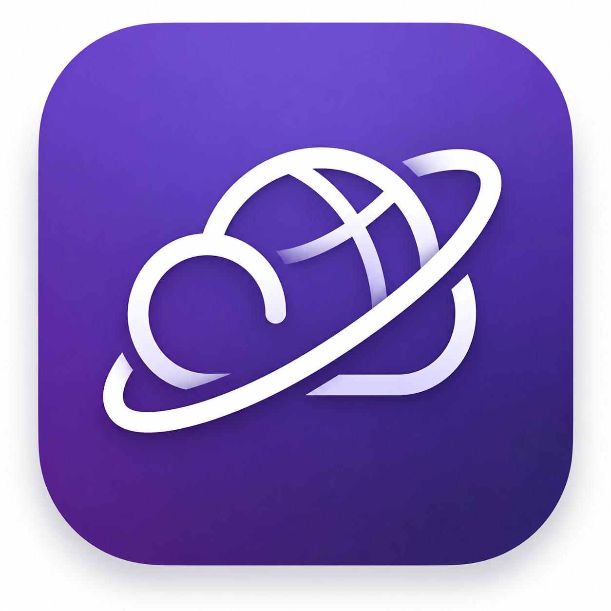
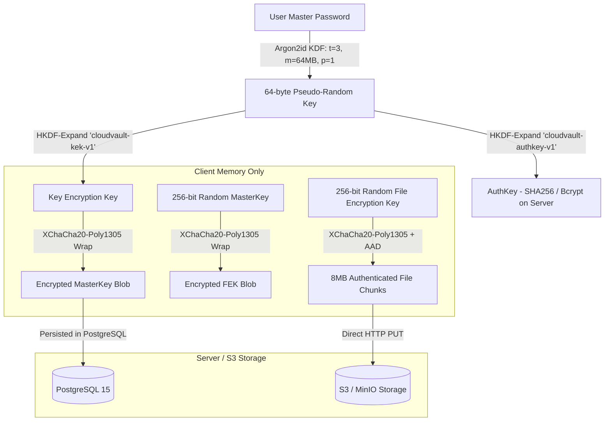

<div align="center">



# CloudVault

### **Next-Generation Zero-Knowledge Cloud Storage Platform**
*End-to-End Client-Side Encrypted Storage • Mathematical Privacy • Direct S3 Acceleration • Multi-Platform*

[](https://www.typescriptlang.org/)
[](https://kotlinlang.org/)
[](https://developer.android.com/jetpack/compose)
[](https://react.dev/)
[](https://www.docker.com/)
[](LICENSE)
[](docs/THREAT_MODEL.md)

<p align="center">
  <a href="#-overview">Overview</a> •
  <a href="#-cryptographic-architecture">Cryptographic Architecture</a> •
  <a href="#-visual-design-system">UI/UX System</a> •
  <a href="#-repository-structure">Structure</a> •
  <a href="#-quick-start">Quick Start</a> •
  <a href="#-api--specifications">APIs</a> •
  <a href="#-milestone-verification">Verification</a>
</p>

</div>

---

## 🌟 Overview

**CloudVault** is an enterprise-grade, zero-knowledge cloud storage platform engineered to guarantee absolute data privacy through client-side cryptography. Unlike traditional cloud services where the server holds decryption keys, CloudVault operates under the fundamental premise: **the server is completely untrusted**. 

Plaintext file contents, filenames, folder hierarchies, and cryptographic keys **never leave the user's client memory**.

### 🛡️ Core Guarantees

- 🔒 **Zero-Knowledge Architecture:** Master keys and file encryption keys are generated and held exclusively on the client (browser Web Worker or Android Keystore).
- ⚡ **Direct-to-S3 Multipart Uploads:** Large files are framed, authenticated, and encrypted into 8MB chunks on-the-fly and streamed directly to S3/MinIO via presigned URLs without backend bottlenecking.
- 🔑 **24-Word Emergency Recovery Kit:** BIP-39 mnemonic generation ensures emergency account access even if master passwords are lost, while strictly preserving zero-knowledge guarantees.
- 📱 **Multi-Platform Consistency:** High-fidelity native Android application (Jetpack Compose + Room) and progressive web app (React 18 + Tailwind CSS + Web Workers) with pixel-perfect visual parity.
- 🛡️ **Anti-Enumeration Protection:** Public prelogin endpoints return indistinguishable deterministic fake salts and KDF iterations for unregistered accounts, preventing user enumeration attacks.

---

## 🔐 Cryptographic Architecture

CloudVault implements a rigorous multi-tiered cryptographic protocol built on libsodium primitives and WebCrypto:



### Protocol Specifications

| Security Domain | Primitive / Algorithm | Standard Parameters & Notes |
| :--- | :--- | :--- |
| **Password Hashing & KDF** | `Argon2id` (RFC 9106) | $t=3$ passes, $m=65536\text{ KiB}$ ($64\text{ MiB}$), $p=1$ lane |
| **Key Derivation** | `HKDF-SHA256` (RFC 5869) | Strict domain separation (`cloudvault-authkey-v1`, `cloudvault-kek-v1`) |
| **Symmetric Encryption** | `XChaCha20-Poly1305` | 256-bit keys, 192-bit random nonces, 128-bit authentication tags |
| **Chunk Framing & AAD** | AEAD with Authenticated Data | 27-byte AAD binding: `[FileID(16B) \|\| ChunkIndex(8B) \|\| IsFinal(1B) \|\| Version(2B)]` |
| **Metadata Protection** | Deterministic Nonces + AEAD | Plaintext file names, extensions, and folder paths encrypted before transfer |
| **Emergency Recovery** | BIP-39 (RFC 1951) | 24-word recovery phrase mapped to 256-bit seed for MasterKey restoration |

---

## 🎨 Visual Design System

CloudVault features an ethereal, deep-space cosmic theme with rich micro-animations, glassmorphism, and responsive dual themes:

<details open>
<summary><b>🌌 Cosmic Theme Highlights (Click to collapse)</b></summary>
<br>

- **Deep Space Void Palette:** Base surface `#0D0B18`, elevated cosmic cards `#161226`, subtle purple borders `#352C55`.
- **Ethereal Light Theme:** Frosted lilac glass cards with lavender planetary gradients (`#EDE7F6` to `#B388FF`).
- **Interactive Micro-Animations:**
  - 🪐 *Saturn & Orbit Ring:* 3D lavender Saturn planet with orbiting rings and astronaut explorer.
  - 🔮 *Floating 3D Pedestal:* Elevated central pedestals with glowing squircle brand emblems.
  - ✉️ *Interactive Verification:* 3D security envelope popping out 6-digit codes with live countdown timers.
  - 📊 *Storage Donut Ring:* Dynamic SVG arc indicator tracking storage consumption against tier quotas.

</details>

---

## 📁 Repository Structure

```
Cloud-Vault/
├── apps/
│   ├── android/              # Native Android App (Kotlin 2.1, Jetpack Compose, Room, WorkManager)
│   ├── android-bench/        # Android Hardware Benchmark Suite (Argon2id physical device harness)
│   └── web/                  # Progressive Web App (React 18, Vite 6, Tailwind CSS, Web Worker Crypto)
├── backend/                  # RESTful API Server (Node.js, Express, TypeORM, PostgreSQL, MinIO S3 SDK)
│   ├── src/
│   │   ├── database/         # TypeORM Schemas, Entities, Versioned Migrations, and Seeds
│   │   ├── middleware/       # Anti-Enumeration, CSRF, Rate Limiting, Authenticate
│   │   ├── routes/           # Auth, Files, Folders, and Storage API endpoints
│   │   └── services/         # Auth, Upload, S3 Presigned Multipart, Email
│   └── tests/                # Unit & Integration test suites (66 tests)
├── packages/
│   └── crypto-spec/          # Source-of-Truth Cryptographic Specification
│       ├── android/          # Pure JVM / Kotlin crypto validation module
│       ├── ts/               # TypeScript crypto reference implementation
│       └── test-vectors/     # Canonical M1 test vectors (v1.json)
├── infra/
│   ├── docker/               # Production Docker Compose (PostgreSQL 15 + Chainguard MinIO)
│   └── terraform/            # S3 bucket lifecycle, CORS, and abort-incomplete-multipart rules
├── docs/                     # Comprehensive Architecture, Decisions, Audits & Benchmarks
│   ├── audits/               # Independent milestone verification reports
│   ├── benchmarks/           # Measured throughput & cryptographic benchmarks
│   ├── m5/                   # Milestone M5 web client specifications
│   ├── m6/                   # Milestone M6 Android architecture & Keystore docs
│   └── research/             # Technical specifications, research papers, and blueprint records
└── package.json              # Root npm workspaces configuration
```

---

## ⚡ Quick Start

### Prerequisites

- **Node.js:** `v20.x` or `v22.x+`
- **Docker & Docker Compose:** Installed and running
- **Java / JDK:** Version 17+ (for Android builds)
- **Android SDK:** API Level 34/35 (optional, for Android APK builds)

### 1. Clone & Install Dependencies

```bash
git clone https://github.com/akaAkshat246/Cloud-Vault-v.1.0.git
cd Cloud-Vault-v.1.0

# Install all workspace dependencies
npm install
```

### 2. Launch Local Cloud Services (PostgreSQL & MinIO)

```bash
# Start PostgreSQL 15 and MinIO S3 containers
npm run docker:up

# Verify services are healthy
docker ps
```

- **MinIO S3 API:** `http://localhost:9000`
- **MinIO Web Console:** `http://localhost:9001` *(User: `minioadmin`, Pass: `minioadmin`)*
- **PostgreSQL Database:** `localhost:5432` *(DB: `cloudvault_db`)*

### 3. Initialize Database Migrations & Seeds

```bash
# Copy backend environment configuration
cp backend/.env.example backend/.env

# Run migrations and plan seeds
npm run db:migrate
npm run db:seed
```

### 4. Build and Start the Application

Open two terminal tabs:

**Terminal 1 (Backend API Service):**
```bash
npm run build:backend
cd backend && node dist/index.js
# Backend listening at http://localhost:4000
```

**Terminal 2 (Frontend Web Client):**
```bash
npm run dev:web
# Web PWA active at http://localhost:3000
```

Visit **`http://localhost:3000`** in your browser to experience CloudVault!

---

## 🧪 Milestone Verification

Run the comprehensive test suites across cryptography, backend, and frontend:

```bash
# 1. Verify Cryptographic Test Vectors (25/25 Tests Passing)
npm run test:crypto

# 2. Run React Web Client Unit & E2E Crypto Suites (24/24 Tests Passing)
npm run test:web

# 3. Run Backend Unit & Security Middleware Suites (32/32 Tests Passing)
npm --workspace=@cloudvault/backend run test -- tests/unit

# 4. Verify Android JVM Crypto Engine (7/7 Vectors Passing)
cd packages/crypto-spec/android && ./gradlew test
```

### Milestone Progress & Tag Matrix

| Milestone | Scope | Deliverables | Tag |
| :--- | :--- | :--- | :--- |
| **M1** | Cryptographic Spec | Argon2id, HKDF-SHA256, XChaCha20-Poly1305, Test Vectors (`v1.json`) | `m1-crypto` |
| **M2** | Backend Core | PostgreSQL 15, TypeORM versioned migrations, structured logging | `m2-backend-core` |
| **M3** | Zero-Knowledge Auth | Anti-enumeration prelogin, dual-key auth, refresh token rotation | `m3-auth` |
| **M4** | Storage Pipeline | Direct-to-S3 chunked multipart upload, HTTP Range downloads | `m4-storage` |
| **M5** | Web Client (PWA) | React 18, Web Workers, BIP-39 recovery kit, responsive cosmic UI | `m5-web-client` |
| **M6** | Native Android | Jetpack Compose, Room, WorkManager, Android Keystore, Debug APK | `m6-android` |

---

## 📱 Android Application

The repository includes a production-grade native Android app located in `apps/android`:

- **UI Framework:** 100% Jetpack Compose with Material 3 and custom Cosmic tokens
- **Offline Persistence:** Room SQLite for encrypted metadata and folder hierarchies
- **Background Transfers:** WorkManager with foreground services and network retry policies
- **Hardware Security:** Android Keystore device-bound MasterKey storage with biometric unlock

To compile the debug APK:
```bash
cd apps/android
./gradlew assembleDebug
# Generated APK: apps/android/app/build/outputs/apk/debug/app-debug.apk
```

---

## 🤝 Contributing

We welcome security reviews, vulnerability reports, and architectural contributions!

1. Fork the Project
2. Create your Feature Branch (`git checkout -b feature/AmazingFeature`)
3. Ensure all test vectors pass (`npm run test:crypto && npm run test:web`)
4. Commit your Changes (`git commit -m 'feat(crypto): add post-quantum hybrid KDF'`)
5. Push to the Branch (`git push origin feature/AmazingFeature`)
6. Open a Pull Request

---

## 📄 License

Distributed under the MIT License. See `LICENSE` for more information.

---

<div align="center">
  <sub>Engineered with precision for absolute zero-knowledge privacy.</sub>
</div>
