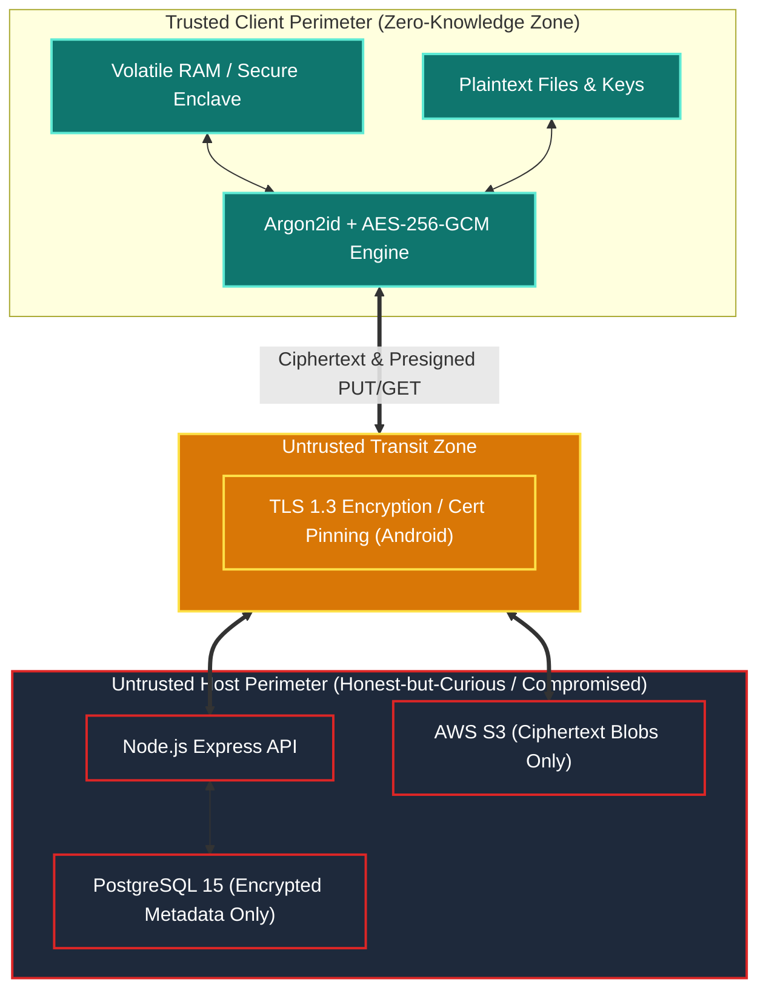

# CloudVault — Threat Model & Security Architecture

> **Document Type:** System Threat Model & Security Posture Specification  
> **Methodology:** STRIDE (Spoofing, Tampering, Repudiation, Information Disclosure, Denial of Service, Elevation of Privilege)  
> **Classification:** Public Technical Architecture / Security Audit Baseline  
> **Lead Security Architect:** Akshat Singh (CV-07) & Akshat Vats (CV-01)  

---

## 1. System Overview & Trust Boundaries

CloudVault is an end-to-end encrypted (E2EE) zero-knowledge cloud storage platform. The primary architectural goal is to guarantee that **no entity outside the user's authenticated client device (including CloudVault servers, database administrators, hosting providers, or subpoenaed authorities) can read file contents or sensitive metadata.**

---

## 2. Honest Metadata Leakage Matrix

In zero-knowledge storage, cryptographic engineering requires complete transparency regarding what metadata is shielded versus what operational metadata remains observable by servers, network transit providers, or adversaries.

| Metadata Attribute | Protected? | Storage / Transmission State | Threat / Privacy Implication | Mitigation & Justification |
|---|---|---|---|---|
| **File Content** | **YES** | Encrypted with unique AES-256-GCM 256-bit FEK before transmission. | Zero knowledge to server or S3. | NIST SP 800-38D AES-GCM with 128-bit authentication tag. |
| **Filename** | **YES** | Encrypted with AES-256-GCM client-side (**ADR-004**). | Server sees only Base64 ciphertext + nonce. | Decrypted only in client memory. Prevents leakage of sensitive document names. |
| **Folder Names** | **YES** | Encrypted with AES-256-GCM client-side. | Server sees opaque string. | Prevents category leakage (e.g. "Medical Records"). |
| **MIME Type** | **YES** | Encrypted inside file metadata payload. | Server sees generic `application/octet-stream`. | Prevents file type profiling (e.g. detecting videos vs spreadsheets). |
| **File Size** | **NO** | Plaintext in PostgreSQL and observable via S3 chunk byte lengths. | Attacker can approximate file size ($\pm 28$ bytes overhead per chunk). | Padding can be introduced in Phase 3; chunking masks exact file size boundaries. |
| **Chunk Count** | **NO** | Stored in PostgreSQL (`chunk_count`) and S3 part counts. | Indicates file magnitude (e.g., 20 chunks $\approx 100$ MB). | Operational requirement for S3 multipart assembly and quota validation. |
| **Timestamps** | **NO** | Plaintext ISO 8601 timestamps (`uploaded_at`, `updated_at`). | Temporal access patterns observable (time of user activity). | Necessary for sync conflict detection and timestamp versioning. |
| **Folder Hierarchy** | **PARTIAL** | Folder IDs (UUIDs) and parent-child edges are stored in DB. | Topology of directory tree (depth, file counts per folder) is visible. | Node names are encrypted, but tree structure is visible to server. |
| **User IP & Agent**| **NO** | Observable by Cloudflare, AWS, and server logs. | Geolocation and device category identifiable by network hosts. | Users can connect via VPN or Tor; audit log retention pruned after 90 days. |

---

## 3. STRIDE Threat Analysis

### 3.1 Spoofing (Identity)
- **Threat:** Attacker impersonates legitimate user via brute force, credential stuffing, or session hijacking.
- **Mitigation:**
  - Client derives `AuthKey` using memory-hard **Argon2id** (64 MiB, t=3, p=1), neutralizing rainbow tables.
  - Server hashes received `AuthKey` with slow **bcrypt (cost factor 12)** before storage.
  - Login endpoints enforce IP-based rate limiting (5 failed attempts per 15 min $\rightarrow$ progressive lockout).
  - Short-lived 15-minute access JWTs; refresh tokens rotated on every call with replay detection.

### 3.2 Tampering (Data Integrity)
- **Threat 1: Ciphertext Tampering on S3 or in Transit:**
  - *Mitigation:* AES-256-GCM provides authenticated encryption. Any bit flip in ciphertext causes GCM tag verification failure on client download, rejecting the corrupted chunk.
- **Threat 2: Chunk Swapping, Reordering, or Truncation:**
  - *Mitigation:* Every 5MB chunk binds Authenticated Additional Data (AAD):
    $$\text{AAD} = \text{format\_version} \parallel \text{file\_id} \parallel \text{chunk\_index} \parallel \text{total\_chunks} \parallel \text{is\_final}$$
    Moving chunk 2 to chunk 1, substituting chunk from another file, or omitting the final chunk fails tag verification immediately.
- **Threat 3: Database Metadata Manipulation:**
  - *Mitigation:* File records include `checksum_sha256` of entire concatenated ciphertext. Mismatches during client download trigger verification error.

### 3.3 Repudiation
- **Threat:** User or administrator denies performing file modifications or deletions.
- **Mitigation:** Append-only PostgreSQL `audit_log` records all authentication attempts, upload initializations, share creations, and deletions with timestamps, user IDs, and client IP addresses.

### 3.4 Information Disclosure (Confidentiality)
- **Threat 1: Compromise of AWS S3 Bucket or Database:**
  - *Mitigation:* S3 contains purely AES-256-GCM ciphertext chunks. PostgreSQL contains only wrapped FEKs (encrypted by client KEK) and encrypted filenames. Neither S3 nor the database holds plaintext or the user's Master Key / KEK.
- **Threat 2: Memory Dump of Database Server:**
  - *Mitigation:* The KEK and Master Key **never traverse the network** to the API server (**ADR-002**). Server RAM never contains vault keys.
- **Threat 3: Loss of User Password:**
  - *Mitigation:* 24-word BIP-39 Emergency Recovery Kit allows user to recover KEK client-side. Zero server escrow prevents backdoor recovery.

### 3.5 Denial of Service (DoS)
- **Threat 1: Memory Exhaustion via Large File Uploads:**
  - *Mitigation:* Base64 upload to Node.js is rejected (**ADR-003**). Large files stream directly from client to AWS S3 via presigned URLs in 5MB chunks.
- **Threat 2: S3 Storage Flooding without Payment:**
  - *Mitigation:* Server checks storage quota in PostgreSQL *before* issuing S3 presigned upload URLs. S3 bucket lifecycle rules purge incomplete multipart uploads after 24 hours.

### 3.6 Elevation of Privilege
- **Threat:** User A attempts to access or modify User B's files.
- **Mitigation:**
  - All file and share endpoints validate that `file.user_id === authenticated_user_id`.
  - Database row-level security and strict repository query scoping ensure no cross-tenant leakage.

---

## 4. Web Trust Model & Accepted Residual Risks

### 4.1 The Web Cryptography Trust Paradox
In any browser-based encrypted web application, the client trusts the server to deliver untampered JavaScript. If the web server or DNS is compromised, an attacker could theoretically inject malicious JavaScript to capture the master password or KEK in memory.
- **Mitigations Implemented:**
  - **Subresource Integrity (SRI):** External scripts are pinned with cryptographic SHA-384 hashes.
  - **Strict Content Security Policy (CSP):** `default-src 'self'; script-src 'self'; object-src 'none'; frame-ancestors 'none'`. Prevents inline script injection, `eval()`, and clickjacking.
  - **HTTP Strict Transport Security (HSTS):** `max-age=63072000; includeSubDomains; preload` prevents SSL stripping.
  - **Future Roadmap:** Web bundle code signing and reproducible builds to facilitate third-party client verification.
- **Native Android Alternative:** Users requiring maximum assurance against dynamic code injection are guided to the **Native Android App**, which is compiled, digitally signed with an APK developer certificate, and auditable.

### 4.2 URL Fragment Link Sharing Risks (**ADR-008**)
- **Residual Risk 1: Browser History Logging:** The URL fragment `#key=<base64_fek>` may be recorded in the recipient's local browser history.
  - *Mitigation:* The recipient client application can scrub `window.location.hash` via `history.replaceState` immediately after reading the key into volatile memory.
- **Residual Risk 2: Shoulder Surfing & Clipboard Snooping:** Sharing links via unencrypted messaging apps (SMS, Discord) exposes the key to those communication channels.
  - *Mitigation:* CloudVault supports **Password-Protected Share Links**, wrapping the FEK in the fragment with a key derived from an out-of-band password known only to the sender and recipient.

---

## 5. Cryptographic Invariants & Nonce Management

1. **Strict Nonce Isolation:** A unique 96-bit nonce is generated via cryptographically secure pseudo-random number generators (`crypto.getRandomValues()` on Web, `SecureRandom` on Android) for **every single chunk**.
2. **Key Uniqueness:** A distinct 256-bit symmetric FEK is generated for each file. An FEK is never reused across files.
3. **Collision Bounds:** Under AES-GCM with a 96-bit random nonce and per-file key, encrypting up to $2^{16}$ chunks (320 GB file) yields a collision probability of $\approx 2^{-65}$, far below the NIST SP 800-38D limit of $2^{-32}$.

