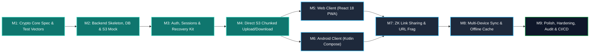

# CloudVault — Comprehensive Implementation Plan & Engineering Roadmap

> **Document Type:** Engineering Implementation Blueprint & Milestone Plan  
> **Source Documents:** Workspace PRDs, Blueprints, Roadmaps, ADRs 001–012, and Stakeholder Amendments  
> **Revised Target Timeline:** 8–9 Weeks (6-Week Core + 30% Buffer for Academic/Hackathon Schedules)  
> **Team Size:** 11 Engineers & Designers across 8 Functional Roles  
> **Author:** Senior Staff Engineer, Security Architect & Technical Lead  

---

## 1. Monorepo Repository Structure

The CloudVault codebase is organized as a unified, modular monorepo using **npm workspaces** to facilitate atomic versioning, shared cryptographic specifications, and clean role separation across the 11-member team.

```text
/cloudvault
├── .github/
│   └── workflows/                # CI/CD pipelines (backend, web, android, security audit)
│       ├── crypto-spec-ci.yml    # M1 Interop gate: Web & Android test vector validator
│       ├── backend-ci.yml
│       ├── web-ci.yml
│       ├── android-ci.yml
│       └── security-audit.yml
├── apps/
│   ├── android/                  # Native Kotlin + Jetpack Compose Android Application (CV-02)
│   │   ├── app/
│   │   │   ├── src/main/java/app/cloudvault/
│   │   │   │   ├── data/        # Room DB, Retrofit APIs, Keystore-backed Token Storage
│   │   │   │   ├── domain/      # UseCases, Models, Crypto Interfaces
│   │   │   │   ├── di/          # Hilt Dependency Injection Modules
│   │   │   │   ├── ui/          # Jetpack Compose Screens, Components, Theme
│   │   │   │   └── workers/     # WorkManager Background Sync & Auto-backup
│   │   │   └── build.gradle.kts
│   │   └── build.gradle.kts
│   │
│   └── web/                      # React 18 + TypeScript Progressive Web App (CV-03)
│       ├── public/               # Manifest, Icons, Favicons, Offline Shell
│       ├── src/
│       │   ├── assets/           # Brand SVGs, Graphic Tokens
│       │   ├── components/       # Radix UI + Tailwind Atomic Components (Atoms, Molecules)
│       │   ├── features/         # Domain Modules (auth, files, preview, shares, settings)
│       │   ├── hooks/            # Custom React Hooks
│       │   ├── pages/            # Page-Level Routes (W1–W11)
│       │   ├── stores/           # Zustand State Stores (AuthStore, FileStore, CryptoStore)
│       │   ├── workers/          # Dedicated Web Worker (crypto.worker.ts)
│       │   └── lib/              # Axios Client, Helpers, Local Cache
│       ├── index.html
│       ├── vite.config.ts
│       ├── tailwind.config.js
│       └── package.json
│
├── backend/                      # Node.js 20 LTS + Express REST API (CV-01, CV-04)
│   ├── src/
│   │   ├── config/               # Environment, S3 Client, DB Config
│   │   ├── controllers/          # HTTP Request Handlers
│   │   ├── database/
│   │   │   ├── entities/         # TypeORM Schema Entities (User, File, Key, Plan, Sync)
│   │   │   ├── migrations/       # Timestamped Versioned TypeORM Migrations (No synchronize)
│   │   │   └── seeds/            # Initial Plans & Test Users Seeder
│   │   ├── middlewares/          # Auth JWT, Rate Limiting, Error Handler, Zod Validation
│   │   ├── repositories/         # TypeORM Data Access Repositories
│   │   ├── routes/               # Express Router Definitions (v1)
│   │   ├── services/             # Business Logic (Quota, S3 Presigning, Sync Journal)
│   │   ├── types/                # TypeScript Interfaces & DTOs
│   │   └── index.ts              # Server Entrypoint
│   ├── tests/                    # Jest Unit & Supertest Integration Suites
│   ├── tsconfig.json
│   └── package.json
│
├── packages/
│   └── crypto-spec/              # Cross-Platform Zero-Knowledge Crypto Standard (Lead, Security)
│       ├── ts/                   # TypeScript Reference Implementation (WebCrypto + libsodium)
│       │   ├── src/
│       │   └── tests/
│       ├── android/              # Kotlin Android Reference Implementation (Libsodium / Tink)
│       │   └── src/test/
│       ├── test-vectors/         # Cross-Platform JSON Test Vectors (Positive & Negative)
│       ├── CRYPTO_SPEC.md        # Cryptographic Specification Standard v1
│       ├── package.json
│       └── tsconfig.json
│
├── infra/                        # Local Dev & Cloud Infrastructure Setup (CV-06a, CV-06b)
│   ├── docker/
│   │   ├── docker-compose.yml    # PostgreSQL 15 + MinIO (S3 Mock) + Redis
│   │   ├── minio-init.sh         # Auto-create CloudVault S3 Buckets & Policies
│   │   └── postgres-init.sql     # Database Extensions (uuid-ossp)
│   ├── nginx/
│   │   └── nginx.conf            # Reverse Proxy & SSL Configuration
│   └── scripts/                  # Seed, Backup, and Deploy Automation
│
├── docs/                         # Architecture, ADRs, Security Model & Reports
│   ├── _analysis/                # Project Understanding, Gaps, Implementation Plan
│   ├── DECISIONS.md              # Architecture Decision Records (ADRs 001–012)
│   ├── THREAT_MODEL.md           # STRIDE Threat Model & Honest Metadata Leakage List
│   ├── API_SPEC.md               # OpenAPI / Swagger Specification
│   ├── benchmarks/               # M1 Benchmark Reports (Argon2id & AES-GCM Throughput)
│   └── PROGRESS.md               # Session State & Milestone Tracking
│
├── package.json                  # Root Workspace Configuration
├── .gitignore
├── .env.example                  # Consolidated Environment Variable Template
└── README.md                     # Project Overview, Setup, and Role Instructions
```

---

## 2. Milestones M1 to M9: Roadmap & Execution Plan



---

### Milestone M1: Crypto Core Specification, Framing & Test Vectors
- **Focus:** Establish the mathematical and cryptographic standard before client or server code is written.
- **Deliverables:**
  - `/packages/crypto-spec/CRYPTO_SPEC.md` (versioned v1).
  - Frozen specifications for Argon2id parameters (m=64MiB, t=3, p=1, 16B salt $\rightarrow$ 32B AuthKey + 32B KEK with domain separation).
  - S3 Multipart Chunk Framing: Plaintext chunk = 5,242,880 bytes (5 MiB). Ciphertext chunk = 5,242,908 bytes ($> 5\text{ MiB}$ min S3 size).
  - AAD Binding: `format_version (2B) || file_id (16B UUID) || chunk_index (4B) || total_chunks (4B) || is_final (1B)`.
  - Key wrapping format specification (`{"v":1,"iv":"...","tag":"...","ct":"..."}`).
  - 24-word BIP-39 Emergency Recovery Kit derivation and password-change re-wrap flow.
  - JSON test vectors (`test-vectors/v1.json`) covering positive and negative cases (tampered tags, swapped chunks, wrong AAD, truncated payloads).
  - Reference implementations: TypeScript (`/packages/crypto-spec/ts`) and Android Kotlin (`/packages/crypto-spec/android`).
  - Benchmarks: Argon2id derivation latency on desktop browser + Android profile, 1GB AES-GCM encryption throughput (`/docs/benchmarks/M1.md`).
- **Acceptance Criteria (Interoperability Gate):**
  - Both TypeScript and Kotlin implementations run the **exact same test vectors** and pass 100%.
  - Any ciphertext chunk encrypted by TypeScript can be decrypted by Kotlin and vice versa.
  - All negative vectors properly fail with authentication errors.
- **Dependencies:** None.
- **Estimated Effort:** 4 Days (+ 1 Day buffer = 5 Days).

---

### Milestone M2: Backend Core Skeleton, PostgreSQL Schemas & S3 Mock
- **Focus:** Data layer, migrations, local containerized infrastructure, and base Express server.
- **Deliverables:**
  - `docker-compose.yml` for PostgreSQL 15, MinIO (local S3), and Redis.
  - TypeORM configuration with complete entities: `Plan`, `User`, `EncryptionKey`, `File`, `SyncLog`, `Session`, `Share`, `AuditLog`.
  - TypeORM versioned migrations (`001_initial_schema.ts`); `synchronize: true` is strictly prohibited (**ADR-009**).
  - Plans seeder: Free 5GB, Personal 100GB (₹149), Pro 1TB (₹349) (**ADR-006**).
  - MinIO initialization script with CORS rules.
  - Centralized error handling, request logging, and health check endpoint (`GET /health`).
- **Acceptance Criteria:**
  - `docker-compose up` cleanly launches services; `npm run migration:run` creates schema without errors.
- **Dependencies:** M1.
- **Estimated Effort:** 5 Days.

---

### Milestone M3: Authentication, Session Management & Recovery Kit
- **Focus:** Secure authentication layer with Dual-Key Argon2id support, JWT refresh token rotation, and zero-escrow account recovery.
- **Deliverables:**
  - Zod request validation schemas.
  - `POST /api/v1/auth/signup`: Validates email uniqueness, verifies salt and recovery payload, hashes client `AuthKey` with bcrypt (cost factor 12) (**ADR-002, ADR-012**), and initializes free plan.
  - Signup challenge: client confirms 3–4 random BIP-39 words before finalizing account creation (**ADR-007**).
  - `POST /api/v1/auth/login`: Authenticates `AuthKey`, creates session, issues 15-min JWT access token, and sets 7-day refresh token in HttpOnly `SameSite=Strict` cookie (Web) or encrypted storage (Android).
  - `POST /api/v1/auth/refresh`: Refresh token rotation with family reuse detection.
  - `POST /api/v1/auth/recover`: Verifies recovery key payload to reset credentials.
  - Rate limiting middleware (5 failed attempts per 15 min $\rightarrow$ lockout).
- **Acceptance Criteria:**
  - 100% test coverage via Supertest; zero plaintexts in server logs; replay attack test revokes token family.
- **Dependencies:** M2.
- **Estimated Effort:** 5 Days.

---

### Milestone M4: Direct-to-S3 Chunked Multipart Upload & Streaming Download
- **Focus:** High-throughput, zero-knowledge file ingestion and retrieval using AWS S3 Presigned URLs.
- **Deliverables:**
  - S3 service integration using `@aws-sdk/client-s3` and `@aws-sdk/s3-request-presigner`.
  - Quota validation service checking user storage limits.
  - `POST /api/v1/files/upload/init`: Accepts encrypted metadata, chunk count, total ciphertext size, sha256 checksum, and wrapped FEK. Initiates S3 Multipart Upload and returns presigned chunk upload URLs.
  - `POST /api/v1/files/upload/complete`: Accepts completed chunk ETags, completes multipart upload, commits file record to PostgreSQL, increments user storage, and logs sync event.
  - `GET /api/v1/files/:fileId/download`: Validates ownership and issues presigned S3 GET URL(s) for ciphertext chunks.
  - File management endpoints: `GET /api/v1/files` (listing), `PATCH /api/v1/files/:fileId` (rename/move), `DELETE /api/v1/files/:fileId` (soft-delete).
- **Acceptance Criteria:**
  - Automated integration test uploads a 20MB file in four 5MB chunks directly to MinIO using presigned URLs and finalizes it.
- **Dependencies:** M2, M3.
- **Estimated Effort:** 6 Days.

---

### Milestone M5: Web Application Client (React 18 PWA)
- **Focus:** Complete, responsive, accessible web frontend implementing the zero-knowledge client pipeline.
- **Deliverables:**
  - Vite + React 18 + TypeScript + Tailwind CSS project with design tokens.
  - Background Web Worker (`crypto.worker.ts`) executing `libsodium-wrappers-sumo` for Argon2id key derivation and AES-256-GCM chunk slicing/encryption.
  - Zustand stores (`useAuthStore`, `useFileStore`, `useCryptoStore` with KEK in RAM only).
  - Auth screens (`W1`): Login, registration, 24-word BIP-39 challenge confirmation modal, Argon2id derivation progress bar.
  - Dashboard (`W2`) & File Browser (`W3`): Left sidebar navigation, folder tree, grid/list view, drag-and-drop upload zone with chunk progress bar, visible encryption padlock badge, and cost-per-file storage display.
  - File Preview (`W4`): Decrypts files client-side on-demand for images, PDFs (`react-pdf`), audio, and text/code files.
  - Storage Gauge widget displaying quota usage and 80%/95% upgrade nudges.
  - PWA service worker with offline app shell caching and install prompt.
- **Acceptance Criteria:**
  - Full round trip in browser: User signs up $\rightarrow$ saves recovery phrase $\rightarrow$ drags 15MB file $\rightarrow$ worker encrypts and uploads to S3 $\rightarrow$ file card displays padlock badge $\rightarrow$ clicking file decrypts and renders PDF preview in browser.
- **Dependencies:** M1, M3, M4.
- **Estimated Effort:** 8 Days.

---

### Milestone M6: Native Android Client (Kotlin + Jetpack Compose)
- **Focus:** Native, offline-first Android application matching Web design and security guarantees.
- **Deliverables:**
  - Kotlin + Jetpack Compose + Material 3 app setup with Hilt dependency injection.
  - Cryptographic engine using `libsodium-jni` / Google Tink for Argon2id derivation and AES-256-GCM chunk encryption.
  - Room SQLite Database with `FileEntity`, `EncryptionKeyEntity`, and `SyncStateEntity`.
  - Android Keystore integration for protecting refresh tokens and enabling `BiometricPrompt` unlock.
  - Auth screens (`M1`): Onboarding wizard, biometric enrollment, recovery phrase challenge prompt.
  - File management screens (`M2 Home`, `M3 Browser`, `M4 Preview`): Scoped Storage file picker, chunked upload queue with persistent foreground notification, decrypted image/PDF viewer.
  - WorkManager service for reliable background uploads and sync retry on network reconnection.
  - Android homescreen AppWidget (`M10`) and Quick Settings tile for rapid upload.
- **Acceptance Criteria:**
  - Cross-platform verification: file uploaded from Android decrypts cleanly on Web PWA, and vice versa.
- **Dependencies:** M1, M3, M4.
- **Estimated Effort:** 10 Days.

---

### Milestone M7: Zero-Knowledge Sharing & Access Controls
- **Focus:** Secure public link sharing with URL fragment key transmission and password gating.
- **Deliverables:**
  - `POST /api/v1/shares`: Creates share record in DB with token, optional expiry date, optional max downloads, and optional password hash.
  - `GET /api/v1/shares/:token`: Public endpoint returning file metadata and presigned download URL.
  - Client-side Share Modal (`W7` & `M7`): Generates `https://cloudvault.app/share/:token#key=<base64_fek>` with copy-to-clipboard, QR code, and expiry picker.
  - Public Share Recipient Page: Decrypts URL fragment in browser, streams ciphertext from S3, verifies auth tag, and initiates decrypted browser download.
  - Password Protection: If enabled, FEK is encrypted with an Argon2id key derived from the share password; recipient page prompts for password prior to decryption.
- **Acceptance Criteria:**
  - Server access logs verify that the `#key=...` fragment is never sent over the wire.
- **Dependencies:** M4, M5, M6.
- **Estimated Effort:** 5 Days.

---

### Milestone M8: Multi-Device Sync, Offline Cache & Conflict Resolution
- **Focus:** Multi-device synchronization, offline cache management, and deterministic collision handling.
- **Deliverables:**
  - Backend `POST /api/v1/sync/check`: Differential query returning events from `sync_log` since client checkpoint.
  - Web client IndexedDB cache caching decrypted file metadata for offline instant browsing.
  - Android Room cache synchronization updating local entities on background poll or push trigger.
  - Conflict Resolution Engine (**ADR-010**): Detects simultaneous offline edits on the same file; forks the newer revision to `<name> (Conflict copy from <device> <timestamp>)` with encrypted conflict filename.
  - Offline sync status badges (Synced, Syncing, Offline) across Web and Android UI.
- **Acceptance Criteria:**
  - Simultaneous offline edits preserve both files cleanly with encrypted conflict naming.
- **Dependencies:** M5, M6.
- **Estimated Effort:** 6 Days.

---

### Milestone M9: Polish, Hardening, Security Audit & CI/CD Release
- **Focus:** Comprehensive security verification, load testing, performance tuning, and release automation.
- **Deliverables:**
  - OWASP Top 10 penetration testing and security audit (CV-07): SQLi, XSS, CSRF, broken access control, CORS audit.
  - Load testing (CV-08) with k6: 100 concurrent uploads and 500 req/sec query benchmarks.
  - Android APK signing configuration and ProGuard/R8 obfuscation rules.
  - GitHub Actions CI/CD pipelines: Lint, type-check, automated unit/integration tests, and Docker container builds.
  - Complete documentation: `/docs/THREAT_MODEL.md`, `/docs/API_SPEC.md`, `/docs/KNOWN_LIMITATIONS.md`.
- **Acceptance Criteria:**
  - Zero critical/high vulnerabilities from automated security scanners; all CI workflows pass green on main branch.
- **Dependencies:** All prior milestones.
- **Estimated Effort:** 6 Days.

---

## 3. Revised Timeline & Academic/Hackathon Risk Buffer

The initial 6-week schedule has been adjusted with a **30% contingency buffer** to yield an **8 to 9 week realistic production delivery plan**, accommodating university examinations and hackathon conflicts:

```text
Week 1: M1 (Crypto Core Spec, Framing, Interop Test Vectors) & M2 (DB, Migrations, S3 Mock)
Week 2: M2 Wrap & M3 (Authentication, Session Management, Recovery Kit)
Week 3: M4 (Direct S3 Presigned Multipart Chunked Ingestion) & Web/Android Client Scaffolding
Week 4: M5 (React 18 PWA Client - Crypto Worker, Browser, Decrypted Preview)
Week 5: M6 (Native Android Compose Client - Room, Keystore, WorkManager Sync)
Week 6: M7 (Zero-Knowledge URL Fragment Sharing & Password Protection)
Week 7: M8 (Multi-Device Sync, Offline Cache & Deterministic Conflict Forking)
Week 8: M9 (Hardening, OWASP Audit, k6 Load Tests, Signed APK, CI/CD Deployment)
Week 9: Buffer / Polish / Play Store Review & Production Rollout
```

---

## 4. Team Role Task Breakdown (11-Member Cross-Functional Team)

| Role ID & Name | Role Title | Active Milestones | Core Responsibilities & Deliverables |
|---|---|---|---|
| **CV-01** — Akshat Vats | **Project Lead & Full Stack** | M1–M9 (All) | Monorepo architecture, `/packages/crypto-spec` lead, Direct S3 presigning engine, code reviews, cross-role interface unblocking. |
| **CV-02** — Akshat Kumar | **Android Developer** | M1, M6, M7, M8, M9 | Native Android app (`/apps/android`), Jetpack Compose UI, Room DB cache, Android Keystore, WorkManager background sync, APK signing. |
| **CV-03** — Akshay Yadav | **React Frontend Dev** | M1, M5, M7, M8, M9 | Web PWA (`/apps/web`), React 18, Tailwind UI, Web Worker crypto integration (`crypto.worker.ts`), Zustand stores, preview viewer. |
| **CV-04** — Akarsh Bhardwaj | **Backend Dev (Support)** | M2, M3, M4, M7, M8 | PostgreSQL TypeORM entities, migration scripts (no sync), Auth JWT rotation, Zod validation schemas, sync log engine. |
| **CV-05a** — Ananya | **UI/UX Designer (Design System)**| M1–M3, M5, M6 | Design tokens, color system, typography, Figma component library, accessibility guidelines (WCAG AA). |
| **CV-05b** — Anokhi Agarwal | **UI/UX Designer (Flows & UI)** | M1–M3, M5, M6 | User journeys, wireframes, upload dropzone animations, encryption proof badges, mobile bottom sheet layouts. |
| **CV-06a** — Arsh Rana | **DevOps Engineer (Infra & AWS)**| M2, M4, M9 | Docker compose (Postgres + MinIO), AWS S3 bucket configuration, IAM least-privilege policies, production EC2/RDS deployment. |
| **CV-06b** — Ashwani Bhardwaj | **DevOps Engineer (CI/CD & Edge)**| M2, M5, M9 | GitHub Actions pipelines, Cloudflare CDN rules, Vercel web deployment, Nginx reverse proxy, automated security scanning. |
| **CV-07** — Akshat Singh | **Security Reviewer** | M1, M3, M4, M9 | Cryptographic verification of Argon2id & AES-GCM framing, OWASP Top 10 penetration testing, Burp Suite API audits, threat modeling. |
| **CV-08** — Anaahita Tripathi | **QA Tester** | M3, M4, M5, M6, M8, M9| Postman API collection, end-to-end integration tests, k6 load testing (100 concurrent uploads), Android device matrix testing. |

---

## 5. Technology Stack & Architectural Justifications

| Layer | Selected Technology | Alternative Evaluated | Engineering Justification |
|---|---|---|---|
| **Backend Runtime** | **Node.js 20 LTS + TypeScript** | Python / FastAPI, Go | Unifies language with frontend, rapid development, rich AWS SDK support, non-blocking I/O for coordination. |
| **Web Server** | **Express.js** | Fastify, NestJS | Lightweight, battle-tested, explicitly documented in source PRDs, lowest friction for 11-member team. |
| **Database** | **PostgreSQL 15** | MySQL, MongoDB | Native UUID support, strict relational constraints, robust JSONB support, ACID transactions for quota accounting. |
| **ORM & Migrations**| **TypeORM** | Prisma, Drizzle, Sequelize | Documented in project specs; provides explicit TypeScript classes, declarative schema migrations (`synchronize: false`). |
| **Cloud Storage** | **AWS S3 Standard** | Google Cloud Storage, B2 | Direct Presigned URL support, standard Multipart API, lifecycle rules for 90-day archival, MinIO parity for local dev. |
| **Web Frontend** | **React 18 + TypeScript + Vite** | Next.js, Vue 3 | Clean SPA/PWA architecture, zero server-side rendering complexity (SSR cannot access client encryption keys anyway). |
| **Web State** | **Zustand + TanStack Query** | Redux Toolkit | Clean separation: TanStack Query for server cache, Zustand for in-memory client state and transient encryption keys. |
| **Web Crypto** | **`libsodium-wrappers-sumo`** | Pure SubtleCrypto | Provides native, audited Argon2id implementation (`crypto_pwhash`) and fast ChaCha20/AES-GCM primitives via WebAssembly. |
| **Android UI** | **Jetpack Compose + Material 3** | Android XML Views | Modern declarative UI, state-driven recomposition, shared token mapping with web design tokens. |
| **Android Crypto** | **`libsodium-jni` / Google Tink** | Bouncy Castle only | Hardware-accelerated Argon2id and AES-256-GCM backed by Android Keystore for key material storage. |
| **Local DB (Android)**| **Room Database (SQLite)** | SQLDelight, Realm | Google's official persistence library, seamless coroutines/Flow integration, robust schema migration support. |
| **Testing** | **Vitest, Jest, Supertest, k6** | Mocha, Cypress | Fast execution, built-in mocking, and k6 provides realistic multi-user streaming load generation. |

---

## 6. Top 10 Risk Register & Mitigations

| # | Risk Description | Severity | Likelihood | Mitigation Strategy |
|---|---|---|---|---|
| **R-01** | **Argon2id UI Freezing / Main Thread Lock** | High | High | Run all Argon2id derivations inside dedicated Web Worker (`crypto.worker.ts`) on web, and `Dispatchers.Default` on Android. |
| **R-02** | **Memory Exhaustion on Large Files** | Critical | Medium | Files are sliced into 5MB chunks via `File.slice()` and streamed sequentially to S3 directly via presigned URLs. |
| **R-03** | **IV / Nonce Reuse in AES-256-GCM** | Catastrophic | Low | Fresh 96-bit cryptographically secure random IV generated for every single chunk; per-file unique FEK guarantees isolation. |
| **R-04** | **Data Loss from User Forgotten Password** | High | Medium | Enforce generation and 3-word challenge confirmation of the 24-word BIP-39 Emergency Recovery Kit (**ADR-007**). |
| **R-05** | **Metadata Leakage in Database** | Critical | High | Encrypt filenames, folder names, and MIME types client-side (**ADR-004**). DB stores only opaque ciphertexts. |
| **R-06** | **Rogue Presigned S3 Upload Quota Bypass**| High | Medium | Server verifies declared size before issuing presigned URLs, and S3 completion checks verify actual stored byte count. |
| **R-07** | **Offline Multi-Device Write Collisions** | Medium | High | Deterministic branch forking preserves conflicting versions as encrypted named conflict copies (**ADR-010**). |
| **R-08** | **Academic Exams & Hackathon Schedule Conflicts**| High | High | Added 30% schedule contingency buffer (8–9 weeks total); contract freezes at M1/M2/M4 enable asynchronous work. |
| **R-09** | **JWT Replay / Session Hijacking** | High | Low | Refresh tokens stored in HttpOnly cookies (Web) or Android Keystore with automatic family rotation and reuse detection. |
| **R-10** | **Android Low-End Device KDF Latency** | Medium | Medium | Benchmark Argon2id on budget Android profiles during M1. If unlock > 1.5s, tune memory/iterations per versioned parameters. |

---

## 7. MVP Scope vs. Post-MVP Scope

### MVP Scope (Milestones M1–M9)
- Full-stack monorepo with Node.js/PostgreSQL/S3 backend, React 18 PWA, and Native Kotlin Android app.
- Zero-knowledge encryption pipeline: Argon2id dual-key derivation + AES-256-GCM chunked file encryption.
- Client-side metadata encryption (filenames, MIME types).
- 24-Word BIP-39 Emergency Recovery Kit with 3-word confirmation gate.
- Direct S3 presigned multipart upload & streaming download with 5MB chunks.
- Storage quota enforcement based on dynamic tiers (Free 5GB / Personal 100GB / Pro 1TB).
- File browser (folders, breadcrumbs, search, sort, soft delete/restore).
- Decrypted in-app file previews (images, PDFs, audio, code).
- Public link sharing with URL fragment keys (`#key=...`) and optional password protection.
- Android offline caching in Room DB and WorkManager background sync.
- Visible encryption proof badges and cost-per-file metrics.
- Complete unit, integration, and security test suites with CI/CD automation.

### Post-MVP Scope (Phases 2, 3, and 4)
- **Phase 2 (Launch & Growth):** TOTP 2FA, Android camera roll auto-backup, file version history timeline, referral viral engine (+2GB), Razorpay billing integration, FIDO2/WebAuthn hardware keys, Android OCR scanner, Material You theming.
- **Phase 3 (Scale & Intelligence):** Built-in document editor (Tiptap v2), real-time collaborative editing (Y.js CRDT), Team workspaces & RBAC, developer REST API & webhooks, and client-side decrypted Claude AI features (summarization, auto-tagging, semantic search) with explicit user opt-in.
- **Phase 4 (Enterprise & Ecosystem):** Electron/Tauri desktop sync client with virtual filesystem driver, delta/block-level sync (CDC), HIPAA/GDPR compliance center, OPAQUE/SRP password-authenticated key exchange.
