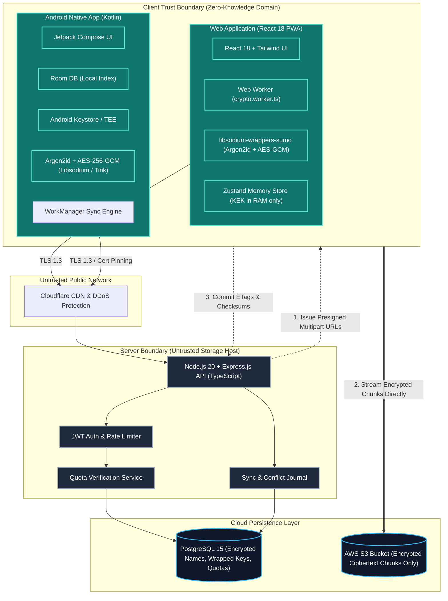
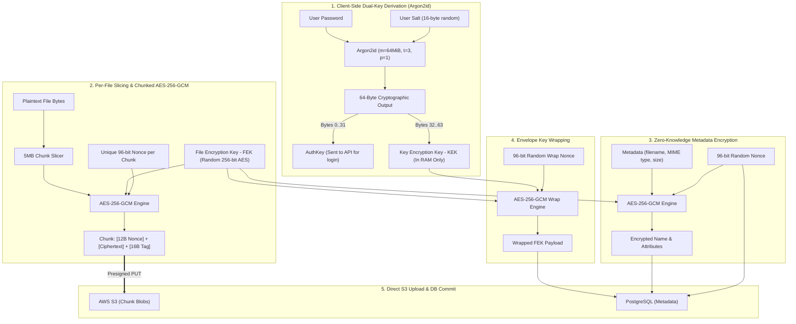

# CloudVault — Project Understanding & System Specification

> **Document Type:** System Architectural Analysis & Frozen Baseline  
> **Source Documents:** Complete workspace documentation (34 files) updated with Architecture Decision Records (ADRs 001–011)  
> **Author:** Senior Staff Engineer, Security Architect & Technical Lead  
> **Date:** November 2026 / Phase 0 Approved Baseline  
> **Classification:** Project Single Source of Truth Synthesis  

---

## 1. Executive Product Summary

**CloudVault** is an enterprise-grade, privacy-first, zero-knowledge end-to-end encrypted (E2EE) cloud storage platform engineered to compete directly against hyperscaler incumbents (Google Drive, Microsoft OneDrive, Dropbox) and established privacy products (Tresorit, Proton Drive, MEGA).

The platform's immutable core thesis is **Zero-Knowledge Privacy at Mass-Market Affordability**:
- **Zero-Knowledge Architecture:** Cryptographic keys are derived and maintained exclusively on client devices (Android native app & Web PWA). The backend server and storage infrastructure store only ciphertext blobs, salt metadata, and encrypted key wraps. At no point in the lifecycle can servers, cloud providers, or subpoenaed entities inspect file contents, directory topologies, or plaintext filenames.
- **Aggressive Market Positioning:** While enterprise-grade zero-knowledge tools like Tresorit charge steep premiums (~₹1,000–₹1,200/month), CloudVault provides identical AES-256-GCM cryptographic guarantees at an accessible domestic entry tier (₹149/month for 100GB), targeting the underserved intersection of privacy-conscious consumers, students, freelancers, and small businesses.
- **Cross-Platform Delivery:** CloudVault launches simultaneously with a high-performance **Android client** (100% Native Kotlin, Jetpack Compose, Room DB, Android Keystore, WorkManager per **ADR-001**) and an installable **Web Progressive Web App (PWA)** (React 18, TypeScript, Tailwind CSS, Web Worker crypto via `libsodium-wrappers-sumo` per **ADR-002**), orchestrated by a resilient **Node.js/Express + PostgreSQL 15 + AWS S3** backend.
- **11-Member Core Team:** Built by an 11-member cross-functional team across 8 distinct roles (CV-01 through CV-08 per **ADR-011**) operating on a structured 6-week MVP sprint.

---

## 2. Complete Feature Inventory (MVP vs. Post-MVP)

Every documented capability is mapped to its delivery milestone and primary source artifacts, incorporating stakeholder decisions.

| # | Feature Capability | Phase / Scope | Description | Source File Reference |
|---|---|---|---|---|
| **F-01** | **Client-Side E2E File Encryption** | **MVP (M1–M6)** | Client-side AES-256-GCM encryption before data leaves memory or device storage. | `CloudVault_Project_Blueprint.pdf`, `Cloud_Storage_Platform_Roadmap.pdf` |
| **F-02** | **Argon2id Dual-Key Derivation** | **MVP (M1, M3)** | Password derives `AuthKey` (login) and `KEK` (key wrap). Server never sees KEK (**ADR-002**). | `cloudvault_complete_feature_guide.html`, `DECISIONS.md` |
| **F-03** | **Zero-Knowledge Metadata Encryption** | **MVP (M1–M4)** | Filenames, folder names, MIME types encrypted client-side (**ADR-004**). | `DECISIONS.md` (ADR-004) |
| **F-04** | **Direct-to-S3 Chunked Multipart Upload** | **MVP (M4)** | 5MB chunks uploaded directly to S3 via short-lived presigned URLs with per-chunk nonces (**ADR-003**). | `cloudvault_frontend_framework.html`, `DECISIONS.md` |
| **F-05** | **Auth & Session Management** | **MVP (M3)** | 15-min access JWT + 7-day refresh token in HttpOnly SameSite cookie; bcrypt cost 12. | `CloudVault_Project_Blueprint.pdf`, `Cloud_Storage_Platform_Roadmap.pdf` |
| **F-06** | **Emergency Recovery Kit** | **MVP (M1, M3)** | 24-word BIP-39 mnemonic recovery phrase for zero-escrow password reset (**ADR-007**). | `DECISIONS.md` (ADR-007) |
| **F-07** | **File Browser & Hierarchical Folders** | **MVP (M5, M6)** | Grid/list view, breadcrumbs, multi-select, drag-drop, rename, move, soft-delete. | `cloudvault_frontend_framework.html`, `cloudvault_screen_solution_report.html` |
| **F-08** | **In-App Decrypted Previews** | **MVP (M5, M6)** | On-demand client-side decryption for images (JPEG, PNG, WebP), PDFs (`react-pdf`), audio, code. | `cloudvault_frontend_framework.html`, `cloudvault_screen_solution_report.html` |
| **F-09** | **Native Android App (Compose + Room)** | **MVP (M6)** | Native Kotlin app, offline-first Room DB, Keystore integration, Scoped Storage (**ADR-001**). | `CloudVault_Roadmap_01_Android_Developer.docx`, `DECISIONS.md` |
| **F-10** | **Web PWA Client** | **MVP (M5)** | React 18, Tailwind, Zustand, Web Worker crypto (`crypto.worker.ts`), installable manifest. | `cloudvault_frontend_framework.html`, `CloudVault_Roadmap_02_React_Frontend_Dev.docx` |
| **F-11** | **Storage Quota Enforcement** | **MVP (M2–M4)** | Database-driven plans table (**ADR-006**); server validates quota before issuing presigned URLs. | `CloudVault_Report_2026.docx`, `DECISIONS.md` |
| **F-12** | **Visible Encryption Proof Indicator** | **MVP (M5, M6)** | Padlock showing cryptographic proof: algorithm, key hash, zero-knowledge verification. | `cloudvault_complete_feature_guide.html`, `cloudvault_screen_solution_report.html` |
| **F-13** | **Cost-Per-File Storage Display** | **MVP (M5, M6)** | Pro-rated storage cost display per file based on user tier (e.g. ₹0.04/mo). | `cloudvault_complete_feature_guide.html`, `cloudvault_screen_solution_report.html` |
| **F-14** | **Zero-Knowledge URL Fragment Sharing** | **MVP (M7)** | Public link with `#key=<fek>`; server never receives key (**ADR-008**). Optional password gate. | `cloudvault_complete_feature_guide.html`, `DECISIONS.md` |
| **F-15** | **Multi-Device Sync & Conflict Forking**| **MVP (M8)** | Differential sync via `sync_log`; conflict fork preserves both versions without data loss (**ADR-010**). | `Cloud_Storage_Platform_Roadmap.pdf`, `DECISIONS.md` |
| **F-16** | **Audit Logging** | **MVP (M2, M3)** | Immutable event log for auth, file uploads, shares, and session revocation. | `CloudVault_Project_Blueprint.pdf`, `Cloud_Storage_Platform_Roadmap.pdf` |
| **F-17** | **Android Biometric Unlock** | **MVP (M6)** | BiometricPrompt gating Android Keystore-held master key material. | `CloudVault_Roadmap_01_Android_Developer.docx`, `DECISIONS.md` |
| **F-18** | **Android Camera Roll Auto-Backup** | **Post-MVP (Phase 2)** | WorkManager + ContentObserver watching MediaStore for background auto-backup. | `cloudvault_complete_feature_guide.html`, `CloudVault_Roadmap_01_Android_Developer.docx` |
| **F-19** | **Two-Factor Authentication (TOTP 2FA)** | **Post-MVP (Phase 2)** | Time-based one-time password via Google Authenticator with recovery codes. | `CloudVault_Project_Blueprint.pdf`, `cloudvault_screen_solution_report.html` |
| **F-20** | **File Version History & Diff** | **Post-MVP (Phase 2)** | 30-day (Personal) / 1-year (Pro) version retention with one-click rollback. | `CloudVault_Report_2026.docx`, `cloudvault_frontend_framework.html` |
| **F-21** | **Referral Program (+2GB Engine)** | **Post-MVP (Phase 2)** | Referral link with dual-sided 2GB bonus storage and leaderboard tracking. | `CloudVault_Report_2026.docx`, `cloudvault_frontend_framework.html` |
| **F-22** | **Billing & Razorpay Integration** | **Post-MVP (Phase 2)** | Subscription management with UPI, debit/credit cards, and automated tax invoices. | `cloudvault_frontend_framework.html`, `CloudVault_Report_2026.docx` |
| **F-23** | **FIDO2 / WebAuthn Hardware Keys** | **Post-MVP (Phase 2)** | Physical YubiKey registration via WebAuthn API on web and Android NFC. | `cloudvault_complete_feature_guide.html`, `cloudvault_screen_solution_report.html` |
| **F-24** | **Android Document Scanner with OCR** | **Post-MVP (Phase 2)** | ML Kit camera edge detection, deskewing, and searchable PDF generator. | `cloudvault_complete_feature_guide.html`, `cloudvault_screen_solution_report.html` |
| **F-25** | **Material You Theming (Android 12+)** | **Post-MVP (Phase 2)** | Dynamic Monet system color extraction mapping into Compose theme. | `cloudvault_screen_solution_report.html`, `cloudvault_complete_feature_guide.html` |
| **F-26** | **Built-in Document Editor** | **Post-MVP (Phase 3)** | Tiptap v2 rich text, Markdown with live preview, Monaco code editor. | `cloudvault_complete_feature_guide.html`, `cloudvault_screen_solution_report.html` |
| **F-27** | **Real-Time Collaborative Editing** | **Post-MVP (Phase 3)** | Y.js CRDT + Hocuspocus WebSocket synchronization for simultaneous co-editing. | `cloudvault_complete_feature_guide.html`, `cloudvault_feature_gap_analysis.html` |
| **F-28** | **Team Spaces & RBAC Organization** | **Post-MVP (Phase 3)** | Multi-tenant organization accounts, shared vaults, Owner/Admin/Editor/Viewer. | `cloudvault_complete_feature_guide.html`, `cloudvault_screen_solution_report.html` |
| **F-29** | **Public Developer REST API & Webhooks**| **Post-MVP (Phase 3)** | Personal access tokens, rate limits, and webhook event dispatch for Zapier/Make. | `cloudvault_complete_feature_guide.html`, `CloudVault_Report_2026.docx` |
| **F-30** | **AI Layer (Claude Sonnet 4 / Search)** | **Post-MVP (Phase 3)** | Client-side decrypted text extraction with explicit user consent (**ADR-005**). | `cloudvault_framework.html`, `DECISIONS.md` |
| **F-31** | **Desktop Client (Electron / Tauri)** | **Post-MVP (Phase 4)** | Windows/macOS/Linux system tray sync client with virtual filesystem driver. | `CloudVault_Project_Blueprint.pdf`, `cloudvault_complete_feature_guide.html` |
| **F-32** | **Delta / Block-Level Sync** | **Post-MVP (Phase 4)** | Content-Defined Chunking (CDC) and rsync differential algorithm. | `cloudvault_complete_feature_guide.html`, `Cloud_Storage_Platform_Roadmap.pdf` |

---

## 3. Architecture Overview & Trust Boundaries



---

## 4. Encryption & Key-Management Model (Frozen Standard)



---

## 5. Database Schemas Summary (Frozen Standard)

### 5.1 PostgreSQL Relational Schema (Server Storage)
*Updated with ADR-002 (Argon2id versioning), ADR-004 (Encrypted metadata), ADR-006 (Dynamic plans), and ADR-007 (Recovery Kit).*

```sql
-- 1. Plans Table (Dynamic commercial tiers per ADR-006)
CREATE TABLE plans (
    plan_id VARCHAR(32) PRIMARY KEY, -- 'free', 'personal', 'pro', 'team'
    name VARCHAR(64) NOT NULL,
    storage_bytes BIGINT NOT NULL,
    price_inr INTEGER NOT NULL DEFAULT 0,
    max_devices INTEGER NOT NULL DEFAULT 2,
    is_active BOOLEAN NOT NULL DEFAULT TRUE,
    created_at TIMESTAMP WITH TIME ZONE DEFAULT CURRENT_TIMESTAMP
);

-- Seed default tiers
INSERT INTO plans (plan_id, name, storage_bytes, price_inr, max_devices) VALUES
('free', 'Free Tier', 5368709120, 0, 2),                  -- 5 GB
('personal', 'Personal Plan', 107374182400, 149, 99999),  -- 100 GB
('pro', 'Pro Plan', 1099511627776, 349, 99999);           -- 1 TB

-- 2. Users Table (With Argon2id metadata and Recovery Payload)
CREATE TABLE users (
    user_id UUID PRIMARY KEY DEFAULT gen_random_uuid(),
    email VARCHAR(255) UNIQUE NOT NULL,
    password_hash VARCHAR(255) NOT NULL, -- bcrypt hash of client-derived AuthKey
    salt VARCHAR(64) NOT NULL,           -- Base64 16-byte random salt for Argon2id
    kdf_algorithm VARCHAR(32) NOT NULL DEFAULT 'argon2id',
    kdf_version VARCHAR(16) NOT NULL DEFAULT '1.0',
    kdf_memory_kib INTEGER NOT NULL DEFAULT 65536,
    kdf_iterations INTEGER NOT NULL DEFAULT 3,
    kdf_parallelism INTEGER NOT NULL DEFAULT 1,
    plan_id VARCHAR(32) NOT NULL REFERENCES plans(plan_id) DEFAULT 'free',
    storage_used_bytes BIGINT NOT NULL DEFAULT 0,
    encrypted_recovery_kek TEXT,         -- KEK wrapped with 24-word recovery key
    recovery_salt VARCHAR(64),
    created_at TIMESTAMP WITH TIME ZONE DEFAULT CURRENT_TIMESTAMP,
    updated_at TIMESTAMP WITH TIME ZONE DEFAULT CURRENT_TIMESTAMP
);

-- 3. Encryption Keys Table (Stores wrapped FEKs)
CREATE TABLE encryption_keys (
    key_id UUID PRIMARY KEY DEFAULT gen_random_uuid(),
    user_id UUID NOT NULL REFERENCES users(user_id) ON DELETE CASCADE,
    wrapped_key TEXT NOT NULL,           -- Base64 JSON: {"iv":"...","tag":"...","ct":"..."}
    created_at TIMESTAMP WITH TIME ZONE DEFAULT CURRENT_TIMESTAMP
);

-- 4. Files Table (Encrypted metadata per ADR-004)
CREATE TABLE files (
    file_id UUID PRIMARY KEY DEFAULT gen_random_uuid(),
    user_id UUID NOT NULL REFERENCES users(user_id) ON DELETE CASCADE,
    parent_folder_id UUID REFERENCES files(file_id) ON DELETE CASCADE,
    is_folder BOOLEAN NOT NULL DEFAULT FALSE,
    encrypted_name TEXT NOT NULL,         -- Base64 ciphertext of original filename
    name_nonce VARCHAR(32) NOT NULL,      -- Base64 12-byte IV for filename
    file_size_bytes BIGINT NOT NULL,      -- Total ciphertext size across all chunks
    chunk_count INTEGER NOT NULL DEFAULT 1,
    key_id UUID NOT NULL REFERENCES encryption_keys(key_id),
    s3_object_prefix VARCHAR(1024) NOT NULL, -- Prefix under which chunks are stored
    checksum_sha256 VARCHAR(64) NOT NULL, -- SHA-256 integrity hash of ciphertext
    is_deleted BOOLEAN NOT NULL DEFAULT FALSE,
    deleted_at TIMESTAMP WITH TIME ZONE,
    uploaded_at TIMESTAMP WITH TIME ZONE DEFAULT CURRENT_TIMESTAMP,
    updated_at TIMESTAMP WITH TIME ZONE DEFAULT CURRENT_TIMESTAMP
);

CREATE INDEX idx_files_user_active ON files(user_id, is_deleted) WHERE is_deleted = FALSE;
CREATE INDEX idx_files_user_parent ON files(user_id, parent_folder_id);

-- 5. Sync Log Table (For multi-device sync and conflict detection per ADR-010)
CREATE TABLE sync_log (
    sync_id BIGSERIAL PRIMARY KEY,
    user_id UUID NOT NULL REFERENCES users(user_id) ON DELETE CASCADE,
    file_id UUID NOT NULL REFERENCES files(file_id) ON DELETE CASCADE,
    action VARCHAR(32) NOT NULL,          -- 'upload', 'delete', 'update', 'rename'
    device_id VARCHAR(128) NOT NULL,
    timestamp TIMESTAMP WITH TIME ZONE DEFAULT CURRENT_TIMESTAMP
);

CREATE INDEX idx_sync_log_user_seq ON sync_log(user_id, sync_id);

-- 6. Sessions Table (JWT Refresh Rotation)
CREATE TABLE sessions (
    session_id UUID PRIMARY KEY DEFAULT gen_random_uuid(),
    user_id UUID NOT NULL REFERENCES users(user_id) ON DELETE CASCADE,
    refresh_token_hash VARCHAR(255) NOT NULL,
    device_name VARCHAR(128),
    ip_address VARCHAR(45),
    expires_at TIMESTAMP WITH TIME ZONE NOT NULL,
    created_at TIMESTAMP WITH TIME ZONE DEFAULT CURRENT_TIMESTAMP
);

-- 7. Shares Table (Public link sharing per ADR-008)
CREATE TABLE shares (
    share_token VARCHAR(64) PRIMARY KEY,  -- Random UUID/Token
    file_id UUID NOT NULL REFERENCES files(file_id) ON DELETE CASCADE,
    created_by UUID NOT NULL REFERENCES users(user_id) ON DELETE CASCADE,
    password_hash VARCHAR(255),           -- Optional bcrypt hash for password-gated shares
    expires_at TIMESTAMP WITH TIME ZONE,
    max_downloads INTEGER,
    download_count INTEGER NOT NULL DEFAULT 0,
    created_at TIMESTAMP WITH TIME ZONE DEFAULT CURRENT_TIMESTAMP
);

-- 8. Audit Log Table
CREATE TABLE audit_log (
    log_id UUID PRIMARY KEY DEFAULT gen_random_uuid(),
    user_id UUID REFERENCES users(user_id) ON DELETE SET NULL,
    action VARCHAR(64) NOT NULL,
    ip_address VARCHAR(45),
    user_agent TEXT,
    timestamp TIMESTAMP WITH TIME ZONE DEFAULT CURRENT_TIMESTAMP
);
```

### 5.2 Android Room SQLite Schema (Local Offline-First Cache)

```kotlin
@Entity(tableName = "files", indices = [Index("parentFolderId"), Index("isDeleted")])
data class FileEntity(
    @PrimaryKey val fileId: String,
    val parentFolderId: String?,
    val isFolder: Boolean,
    val encryptedName: String,
    val nameNonce: String,
    val decryptedNameCache: String?, // Decrypted in memory and cached locally
    val fileSizeBytes: Long,
    val keyId: String,
    val s3ObjectPrefix: String,
    val checksumSha256: String,
    val isDeleted: Boolean = false,
    val localCacheUri: String? = null,
    val syncStatus: String = "SYNCED", // "SYNCED", "PENDING_UPLOAD", "PENDING_DELETE"
    val updatedAt: Long
)

@Entity(tableName = "encryption_keys")
data class EncryptionKeyEntity(
    @PrimaryKey val keyId: String,
    val wrappedKey: String
)

@Entity(tableName = "sync_state")
data class SyncStateEntity(
    @PrimaryKey val id: Int = 1,
    val lastSyncId: Long = 0,
    val lastSyncTimestamp: Long = 0
)
```

---

## 6. Complete API Endpoint Catalog (REST v1)

### Authentication & Account
- `POST /api/v1/auth/signup` — Register with email, AuthKey bcrypt hash, salt, and recovery payload.
- `POST /api/v1/auth/login` — Authenticate AuthKey, issue 15-min JWT access token and 7-day refresh cookie.
- `POST /api/v1/auth/refresh` — Rotate refresh token and issue new access JWT.
- `POST /api/v1/auth/logout` — Invalidate session and clear refresh cookie.
- `POST /api/v1/auth/recover` — Verify recovery key payload and reset credentials.
- `GET  /api/v1/user/profile` — Fetch current user details, storage usage, and plan quotas.
- `PATCH /api/v1/user/profile` — Update account profile settings.
- `POST /api/v1/user/password` — Change password and update wrapped FEK records.

### S3 Direct Chunked Upload (ADR-003)
- `POST /api/v1/files/upload/init` — Client submits encrypted metadata, ciphertext size, chunk count, and wrapped FEK. Server enforces quota and returns S3 upload ID and presigned chunk PUT URLs.
- `POST /api/v1/files/upload/complete` — Client submits completed chunk ETags. Server verifies object in S3, commits PostgreSQL record, and emits sync event.
- `POST /api/v1/files/upload/abort` — Cancel in-progress multipart upload and cleanup S3 parts.

### File & Folder Management
- `GET    /api/v1/files` — List active files/folders for parent folder. Returns encrypted names.
- `GET    /api/v1/files/:fileId/download` — Issue short-lived presigned S3 GET URL(s) for ciphertext chunks.
- `GET    /api/v1/files/:fileId/metadata` — Retrieve file metadata, checksum, chunk manifest, and key ID.
- `PATCH  /api/v1/files/:fileId` — Rename (update encrypted name), move parent folder, or soft-delete.
- `DELETE /api/v1/files/:fileId` — Soft delete file (moves to trash bin).
- `DELETE /api/v1/files/:fileId/permanent` — Permanently purge file from S3 and database.

### Storage & Synchronization
- `GET  /api/v1/storage/usage` — Fetch real-time storage metrics and tier limits.
- `POST /api/v1/sync/check` — Fetch all changes from `sync_log` since `last_sync_id`.
- `GET  /api/v1/sync/journal` — Inspect audit sync log for active client.

### Sharing & Security
- `POST   /api/v1/shares` — Create share link with optional password hash, expiry, and download limits.
- `GET    /api/v1/shares/:token` — Fetch public share metadata and presigned download URL.
- `DELETE /api/v1/shares/:token` — Revoke share link.
- `GET    /api/v1/sessions` — List active login sessions and device IDs.
- `DELETE /api/v1/sessions/:sessionId` — Remotely revoke a specific session.

---

## 7. UI/UX Design System & Screen Topology

### 7.1 Design Tokens (Tailwind CSS Configuration)
- **Primary Accent:** `--cv-teal-600` (`#0f766e`), `--cv-teal-300` (`#5eead4`)
- **Backgrounds:** `--cv-dark-950` (`#0f172a`), Surface: `--cv-dark-800` (`#1e293b`), Border: `--cv-dark-700` (`#334155`)
- **Text:** Primary `--cv-slate-100` (`#f1f5f9`), Muted `--cv-slate-400` (`#94a3b8`)
- **Status:** Danger `--cv-red-600` (`#dc2626`), Warning `--cv-amber-600` (`#d97706`), Success `--cv-green-600` (`#16a34a`)
- **Typography:** Display: `Plus Jakarta Sans`, Body: `Inter`, Monospace: `JetBrains Mono`

### 7.2 Core Screens
- **Web PWA Screens (W1–W11):**
  - `W1 Auth & Onboarding` (Login, Register, Recovery Key Kit generation, Passphrase derivation progress)
  - `W2 Dashboard / Home` (Storage gauge, recent files, upload shortcut, active shares summary)
  - `W3 File Browser` (Folder navigation, grid/list view, drag-and-drop zone, padlock encryption proof)
  - `W4 File Preview` (Client-side decrypted viewer for PDF, images, video, code, and version history)
  - `W6 Search Results` (Client-side decrypted search across filenames and tags)
  - `W7 Sharing & Collaboration` (URL fragment `#key` share link generator, password protection toggle)
  - `W9 Insights Dashboard` (Storage usage by category, duplicate candidates, cost-per-file metrics)
  - `W11 Settings` (Account, security keys, active sessions manager, plan upgrade)
- **Android Native Screens (M1–M10):**
  - `M1 Auth & Biometrics` (Argon2id derivation, BiometricPrompt unlock, recovery phrase prompt)
  - `M2 Home / Recents` (Horizontal recents cards, central upload FAB, storage quota bar)
  - `M3 File Browser` (Swipe left to delete/share, offline cache indicator, Scoped Storage picker)
  - `M4 File Preview` (Bottom sheet decryption viewer, quick share to Android apps)
  - `M7 Share Sheet` (System share sheet integration, expiring link generator)
  - `M8 Notifications` (Foreground sync progress bar, share access alerts)
  - `M9 Settings` (Camera auto-backup settings, Wi-Fi only toggle, bandwidth throttle)
  - `M10 Widget` (Android AppWidgetProvider homescreen widget + Quick Settings tile)

---

## 8. Non-Functional Requirements (NFRs)

1. **Security & Cryptographic Hygiene:**
   - Zero-Knowledge strictly preserved: server and S3 never receive plaintext or KEK.
   - Per-chunk unique 96-bit nonces prevent IV reuse. 128-bit GCM tag verified on every chunk.
   - Argon2id configured for high memory hardness (`m=64MiB, t=3, p=1`).
2. **Performance:**
   - Web crypto runs strictly in a background Web Worker (`crypto.worker.ts`) to maintain 60 FPS UI.
   - Direct S3 uploads achieve full bandwidth saturation without Node.js proxy bottlenecks.
   - Low-end Android unlock benchmark target: < 1.5 seconds.
3. **Offline & Resilience:**
   - Android client maintains a fully functional local offline cache in Room DB.
   - Concurrent offline file edits resolved deterministically via branch forking without silent overwrites (**ADR-010**).
