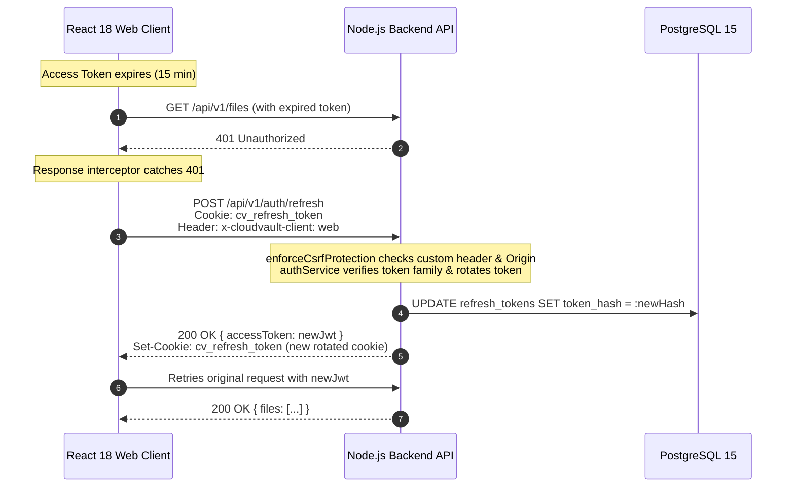

# CLOUDVAULT — M5 API INTEGRATION MAP
## Web Client REST Integration with M2–M4 Backend Infrastructure

> **Milestone:** M5 — Web Client Tier  
> **Status:** Fully Integrated & Verified  
> **Backend Base URL:** `/api` (Proxied via Vite to `http://localhost:4000`)  
> **Object Storage Endpoint:** `http://localhost:9000` (Local MinIO S3)  

---

## 1. ENDPOINT INTEGRATION MATRIX

| Module | HTTP Method & Path | Frontend Consumer | Payload / Parameters | Response Handling | Security & Headers |
| :--- | :--- | :--- | :--- | :--- | :--- |
| **Auth** | `POST /v1/auth/prelogin` | `authApi.prelogin` | `{ email }` | `{ salt, kdf_version, kdf_params }` | Anti-user enumeration; timing parity for unknown emails |
| **Auth** | `POST /v1/auth/register` | `authApi.register` | `{ email, authKey, salt, encrypted_master_key, master_key_nonce, encrypted_recovery_master_key, recovery_master_key_nonce }` | `201 Created` with user entity & JWT tokens | Server never receives plaintext password, KEK, or MasterKey |
| **Auth** | `POST /v1/auth/login` | `authApi.login` | `{ email, authKey }` | `{ accessToken, encrypted_master_key, master_key_nonce }` + `Set-Cookie: cv_refresh_token` | `httpOnly`, `SameSite=Strict` cookie |
| **Auth** | `POST /v1/auth/refresh` | `apiClient` response interceptor | None (Uses cookie) | `{ accessToken, refreshToken }` | Protected with `x-cloudvault-client: web` CSRF header |
| **Auth** | `POST /v1/auth/logout` | `authApi.logout` | None (Uses cookie) | `200 OK` (Clears `cv_refresh_token` cookie) | Clears in-memory auth state |
| **Auth** | `POST /v1/auth/verify-email` | `authApi.verifyEmail` | `{ token }` | `200 OK` (`{ message }`) | Updates `is_email_verified = true` |
| **Auth** | `POST /v1/auth/resend-verification` | `authApi.resendVerification` | `{ email }` | `200 OK` (`{ message }`) | Generic response prevents account enumeration |
| **Auth** | `POST /v1/auth/change-password` | `authApi.changePassword` | `{ oldAuthKey, newAuthKey, new_wrapped_master_key, new_key_nonce, new_kdf_salt }` | `200 OK` | Re-wraps existing MasterKey; zero file re-encryption |
| **Auth** | `GET /v1/auth/sessions` | `authApi.getSessions` | None | `{ sessions: SessionItem[] }` | Displays active sessions and device names |
| **Auth** | `DELETE /v1/auth/sessions/:id` | `authApi.revokeSession` | Session ID parameter | `200 OK` | Revokes specific refresh token family |
| **Storage** | `POST /v1/files/uploads` | `filesApi.initiateUpload` | `{ expected_bytes, total_chunks, chunk_size, encrypted_name, name_nonce, encrypted_fek, fek_nonce, folder_id }` | `{ session_id, file_id, parts: [{ part_number, presigned_url }] }` | Two-phase quota reservation query in PostgreSQL |
| **Storage** | `POST /v1/files/uploads/:id/parts` | `filesApi.getPartUrls` | `{ chunk_indices: number[] }` | `{ parts: [{ part_number, presigned_url }] }` | Generates batch presigned S3 URLs |
| **Storage** | `PUT <presigned_url>` | `useUpload` | Raw encrypted wire chunk (`ArrayBuffer`) | HTTP 200 with `ETag` header | Direct-to-S3; bypasses Express Node server |
| **Storage** | `POST /v1/files/uploads/:id/complete` | `filesApi.completeUpload` | `{ parts: [{ part_number, etag }] }` | `200 OK` with active `FileItemResponse` | Verifies actual size <= expected size, commits quota |
| **Storage** | `POST /v1/files/uploads/:id/abort` | `filesApi.abortUpload` | Session ID parameter | `200 OK` | Aborts S3 multipart upload & refunds reserved quota |
| **Storage** | `GET /v1/files/:id/download-info` | `filesApi.getDownloadInfo` | File ID parameter | `{ download_url, encrypted_fek, fek_nonce, total_chunks, format_version }` | Presigned S3 GET URL |
| **Storage** | `GET <download_url>` | `useDownload` | None | Raw encrypted wire ciphertext | Direct-from-S3 download |
| **Metadata** | `GET /v1/files` | `filesApi.listFiles` | Optional `?folder_id=...` | `{ files: FileItemResponse[] }` | Decrypted client-side using MasterKey |
| **Metadata** | `DELETE /v1/files/:id` | `filesApi.trashFile` | File ID parameter | `200 OK` | Soft-deletes file |
| **Folders** | `GET /v1/folders` | `foldersApi.listFolders` | Optional `?parent_id=...` | `{ folders: FolderItemResponse[] }` | Decrypted client-side using MasterKey |
| **Folders** | `POST /v1/folders` | `foldersApi.createFolder` | `{ encrypted_name, name_nonce, parent_id }` | `201 Created` with Folder item | Encrypted with MasterKey prior to transmission |

---

## 2. CSRF & REFRESH TOKEN LIFECYCLE

