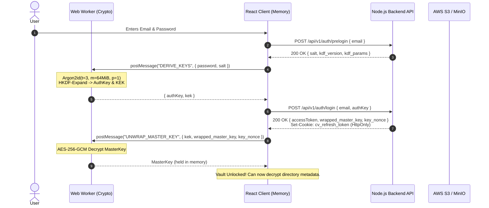

# CLOUDVAULT — MILESTONE M5 IMPLEMENTATION PLAN
## Production React 18 Progressive Web Application (PWA)

> **Document Type:** M5 Master Architectural & Engineering Implementation Plan  
> **Target Package:** `/apps/web`  
> **Status:** Authorized & Under Active Execution  
> **Date:** November 2026 (Environment Timestamp: 13 Nov 2026)  
> **Author:** Principal Frontend Architect, Senior React Engineer, Application Security Engineer  

---

## 1. EXECUTIVE SUMMARY & OBJECTIVES

Milestone M5 delivers the web client tier for CloudVault: a modern, zero-knowledge, end-to-end encrypted Progressive Web Application (PWA) built with **React 18**, **TypeScript**, **Vite**, **Tailwind CSS**, and **React Router v6**, deeply integrated with the M1 cryptographic primitives (`@cloudvault/crypto-spec`), M2–M3 backend APIs (PostgreSQL, session family rotation, anti-enumeration, zero-knowledge auth), and M4 high-performance direct-to-S3 storage infrastructure.

### Core Objectives:
1. **Preserve Zero-Knowledge Security Perimeter:** Passwords, KEK, MasterKey, FEKs, and plaintext filenames never touch the server, persistent browser storage (`localStorage`/`IndexedDB`), logs, or network requests.
2. **Byte-for-Byte Cryptographic Parity:** Reuse `@cloudvault/crypto-spec` with WebAssembly Libsodium in a dedicated Web Worker to ensure seamless cross-platform interoperability with Native Android and CLI.
3. **High-Performance Chunked Direct-to-S3 Transfers:** Implement two-phase quota reservation, 5 MiB chunk slicing, client-side AES-256-GCM chunk encryption/decryption, presigned multipart upload/download, and pause/resume/cancellation.
4. **Resilient Session & State Management:** In-memory token management, HttpOnly refresh cookie handling, silent token refresh with CSRF protection, and automatic session recovery.
5. **PWA & Offline Application Shell:** Web App Manifest, Service Worker caching for immutable application shell assets (with strict exclusion of any key, auth token, or plaintext data), and installability prompts.
6. **Sophisticated Minimalist SaaS UI/UX:** Dark-mode cybersecurity design aesthetic (`#0a0f1a` palette, teal `#0f766e` security accents, slate `#1e293b` borders, responsive layouts across mobile, tablet, and desktop).

---

## 2. FRONTEND ARCHITECTURE & DIRECTORY STRUCTURE

The application lives in `apps/web` within the npm workspaces monorepo. It consumes `@cloudvault/crypto-spec` directly as a workspace dependency.

```text
apps/web/
├── index.html                           # Root HTML with strict CSP and PWA meta tags
├── package.json                         # Workspace package manifest
├── tsconfig.json                        # TypeScript strict compiler options
├── tsconfig.node.json                   # Vite node config tsconfig
├── vite.config.ts                       # Vite bundler, proxy, worker configuration
├── tailwind.config.js                   # Design tokens, color palette, animations
├── postcss.config.js                    # PostCSS plugins
├── public/
│   ├── favicon.ico
│   ├── favicon.svg
│   ├── manifest.json                    # PWA Web App Manifest
│   ├── icons/                           # PWA icons (192x192, 512x512, maskable)
│   └── sw.js                            # Standalone Service Worker for App Shell
├── src/
│   ├── main.tsx                         # React 18 createRoot bootstrap
│   ├── App.tsx                          # App routing, error boundary, auth providers
│   ├── app/
│   │   ├── routes.tsx                   # Route definitions (public, protected, auth)
│   │   └── Layout.tsx                   # App shell, responsive sidebar, header, banners
│   ├── api/
│   │   ├── client.ts                    # Axios/fetch HTTP client with interceptors & CSRF
│   │   ├── auth.api.ts                  # Prelogin, login, register, refresh, logout, recovery
│   │   ├── files.api.ts                 # List, upload sessions, complete, abort, delete, download
│   │   ├── folders.api.ts               # Folder CRUD, tree traversal
│   │   └── user.api.ts                  # Me, quota usage, session management
│   ├── crypto/
│   │   ├── crypto-bridge.ts             # Web Worker RPC dispatcher & fallback adapter
│   │   ├── session-keys.ts              # In-memory ephemeral MasterKey/KEK manager
│   │   ├── file-cipher.ts               # File slicing, chunk encryption, AAD constructor
│   │   └── metadata-cipher.ts           # Filename/folder name AES-GCM encryption & decryption
│   ├── workers/
│   │   └── crypto.worker.ts             # Dedicated Web Worker for off-main-thread Argon2id & AES
│   ├── features/
│   │   ├── landing/                     # Landing page, value proposition, feature comparison
│   │   ├── auth/                        # Prelogin, LoginForm, RegisterForm, RecoveryModal
│   │   ├── verification/                # Email verification banner, token handler, resend modal
│   │   ├── dashboard/                   # Storage quota overview, recent files, statistics
│   │   ├── files/                       # File list, grid/list view, context menu, rename, delete
│   │   ├── folders/                     # Folder tree, breadcrumb navigation, new folder modal
│   │   ├── upload/                      # Drag-and-drop zone, chunked upload queue, progress bars
│   │   ├── download/                    # Download manager, Range decryption, file save stream
│   │   └── settings/                    # Account profile, active sessions, security audit
│   ├── components/
│   │   ├── ui/                          # Button, Input, Modal, Badge, ProgressBar, Toast
│   │   └── feedback/                    # LoadingSpinner, ErrorFallback, EmptyState
│   ├── hooks/
│   │   ├── useAuth.ts                   # Authentication context hook
│   │   ├── useVault.ts                  # Decrypted file tree and directory navigation
│   │   ├── useUpload.ts                 # Upload manager queue hook
│   │   ├── useDownload.ts               # File download and streaming decryption hook
│   │   └── usePWA.ts                    # Service worker registration & install prompt hook
│   ├── store/
│   │   ├── auth.store.ts                # In-memory auth state (user, accessToken, ephemeral keys)
│   │   └── vault.store.ts               # Decrypted folders/files cache and upload queue
│   ├── types/
│   │   ├── api.types.ts                 # Backend DTOs matching openapi.yaml
│   │   ├── crypto.types.ts              # Key bundles, chunk framing, worker message types
│   │   └── vault.types.ts               # Decrypted file metadata, folder nodes
│   └── styles/
│       └── index.css                    # Tailwind directives, fonts, scrollbar styles
└── tests/
    ├── unit/                           # Component and utility unit tests
    ├── crypto/                         # Crypto worker and test-vector parity tests
    └── integration/                    # Mocked and live API flow tests
```

---

## 3. ZERO-KNOWLEDGE CRYPTOGRAPHIC LIFECYCLE & INVARIANTS

### 3.1 Strict Security Invariants
1. **No Plaintext Passwords Transmitted:** The user's master password is used strictly inside the client's Web Worker to compute `PRK = Argon2id(password, salt, t=3, m=64MiB, p=1)`.
2. **Dual-Key Domain Separation:**
   - `AuthKey` = `HKDF-Expand(PRK, "cloudvault-auth-key-v1", 32)`: Sent over TLS 1.3 to backend.
   - `KEK` = `HKDF-Expand(PRK, "cloudvault-kek-key-v1", 32)`: Retained strictly in browser volatile RAM. Never sent to server.
3. **MasterKey Wrapping:**
   - At registration, client generates 32 cryptographically random bytes (`MasterKey`).
   - `wrapped_master_key` = `AES-256-GCM(KEK, IV=12B, MasterKey, AAD="cloudvault-master-key-v1")`.
   - `encrypted_recovery_master_key` = `AES-256-GCM(RecoveryKey, IV=12B, MasterKey, AAD="cloudvault-recovery-master-key-v1")`.
4. **File Encryption Keys (FEK):**
   - Each uploaded file gets a unique 256-bit CSPRNG `FEK`.
   - `encrypted_fek` = `AES-256-GCM(MasterKey, IV=12B, FEK, AAD="cloudvault-fek-v1")`.
   - The file payload is encrypted in 5 MiB chunks with the `FEK`. The backend never possesses the `FEK` or `MasterKey`.
5. **Encrypted Metadata (Zero-Knowledge Directory Tree):**
   - Filenames and folder names are encrypted with `MasterKey` using `AES-256-GCM`:
     - Ciphertext = `AES-256-GCM(MasterKey, IV=12B, UTF8(name), AAD="cloudvault-metadata-v1")`.
     - Database stores only `encrypted_name` and `name_nonce`.
   - Client decrypts directory metadata locally upon fetch. Search, sorting, and tree hierarchy reconstruction happen entirely in browser memory.
6. **Zero Key Persistence in LocalStorage / IndexedDB:**
   - Plaintext keys (`MasterKey`, `KEK`, `FEK`) and decrypted file buffers exist **only** in JavaScript volatile memory (closure state) during the active user session.
   - On page refresh or tab closure, user must re-authenticate (or enter quick-unlock PIN if Web Keystore / WebAuthn is configured in future).
   - Logout immediately wipes memory references and clears session state.



---

## 4. AUTHENTICATION & SESSION MANAGEMENT LIFECYCLE

1. **Pre-Login Phase (Anti-User Enumeration):**
   - Client calls `POST /api/v1/auth/prelogin`.
   - If the account does not exist, backend returns deterministic mock salt and params; user derivation time is identical.
2. **Access & Refresh Tokens:**
   - `accessToken`: Short-lived (15 min) JWT kept in volatile memory (`auth.store.ts`). Never written to `localStorage`.
   - `refreshToken`: 7-day token stored in `HttpOnly`, `Secure`, `SameSite=Strict` cookie (`cv_refresh_token`).
3. **Silent Token Refresh & CSRF Protection:**
   - Axios request interceptor injects `Authorization: Bearer <accessToken>` and `x-cloudvault-client: web` header.
   - Response interceptor catches `401 Unauthorized`. Queues pending requests and calls `POST /api/v1/auth/refresh`.
   - CSRF header `x-cloudvault-client: web` satisfies `enforceCsrfProtection` backend middleware.
   - If refresh returns `403` (token family reuse detected or session expired), client clears local memory and routes user to `/login` with an expiration toast.
4. **Registration & 24-Word Emergency Recovery Kit:**
   - Client generates 24-word BIP-39 mnemonic phrase.
   - Interactive modal displays phrase to user with copy/print options.
   - **Mandatory Challenge-Response:** User must verify 3 randomly chosen words (e.g. Word #3, Word #12, Word #20) before submission.
   - Client derives `RecoveryKey` from phrase and produces `encrypted_recovery_master_key`.
   - Sends `POST /api/v1/auth/register`. Calls `POST /api/v1/auth/recovery/confirm` after challenge pass.

---

## 5. CHUNKED DIRECT-TO-S3 UPLOAD & DOWNLOAD LIFECYCLE

### 5.1 Upload Pipeline (5 MiB Chunk Slicing)
1. **File Selection:** User selects file via Drag-and-Drop or file picker.
2. **Key & Metadata Generation:**
   - Generate fresh 256-bit `FEK`. Wrap with `MasterKey` -> `encrypted_fek` + `fek_nonce`.
   - Encrypt filename with `MasterKey` -> `encrypted_name` + `name_nonce`.
3. **Phase 1: Quota Reservation & S3 Session Initiation:**
   - Compute total chunks $N = \lceil \text{file.size} / 5,242,880 \rceil$.
   - Ciphertext expected size $= \text{file.size} + 28 \times N$.
   - Call `POST /api/v1/files/uploads` -> receives `session_id`.
4. **Phase 2: Chunk Slicing, Encryption & Direct S3 PUT:**
   - Slices file into 5 MiB pieces using `file.slice(start, end)`.
   - For chunk $i \in [0, N-1]$:
     - Worker generates fresh 12-byte random IV.
     - Constructs 27-byte AAD: `version (2B) | file_id (16B UUID) | chunk_idx (4B) | total_chunks (4B) | is_final (1B)`.
     - Worker computes `AES-256-GCM(FEK, IV, chunkBytes, AAD)`.
     - Prepends IV (12B) and appends Tag (16B) -> framed chunk (5,242,908 bytes).
   - Fetch batch presigned URL from `POST /api/v1/files/uploads/:id/parts`.
   - Send raw `PUT <presigned_url>` with payload `Content-Type: application/octet-stream`.
   - Capture `ETag` from S3 response header.
5. **Phase 3: Finalization:**
   - Post all `{ partNumber, eTag }` to `POST /api/v1/files/uploads/:id/complete`.
   - Server verifies S3 object size, updates quota, marks file `ACTIVE`.
   - Client refreshes vault file list.

### 5.2 Download & Streaming Decryption Pipeline
1. **Fetch Download Metadata:**
   - Call `GET /api/v1/files/:id/download-info`.
   - Returns presigned S3 download URL, `encrypted_fek`, `fek_nonce`, `total_chunks`, `chunk_size`.
2. **Unwrap FEK:**
   - Worker decrypts `FEK` using `MasterKey`.
3. **Direct S3 Fetch & Decryption:**
   - Fetch encrypted file from S3 presigned URL (or use HTTP `Range: bytes=start-end` for selective chunk retrieval).
   - Read 12B IV from chunk head, 16B Tag from chunk tail, ciphertext body in between.
   - Worker verifies AAD and decrypts chunk using `FEK`.
4. **Client-Side File Assembly:**
   - Assemble decrypted plaintext chunks into a `Blob`.
   - Trigger browser download via `URL.createObjectURL(blob)` with decrypted filename. Revoke object URL after trigger.

---

## 6. PWA ARCHITECTURE & APP SHELL SPECIFICATION

1. **Web App Manifest (`public/manifest.json`):**
   - App name: `CloudVault`
   - Short name: `CloudVault`
   - Theme color: `#0a0f1a` (Background: `#0a0f1a`)
   - Display: `standalone`
   - Orientation: `any`
   - Icons: SVG and high-res PNG (192x192, 512x512 maskable).
2. **Service Worker (`public/sw.js`):**
   - Cache Strategy: **Cache-First** strictly for immutable static assets (`.js`, `.css`, `.svg`, fonts, `/index.html` shell).
   - **Zero Caching Rule:** Network requests matching `/api/*`, presigned S3 URLs (`localhost:9000` or `*.amazonaws.com`), auth tokens, and decrypted file blobs are **STRICTLY EXCLUDED** from Service Worker caches.
   - Offline fallback: Displays a clean offline application shell indicating network connectivity loss.

---

## 7. USER INTERFACE & COMPONENT SPECIFICATION

### Color Tokens & Styling System:
- **Background Deep:** `#0a0f1a` (Vite body background)
- **Card / Surface Dark:** `#111827` / `#0f172a`
- **Surface Hover:** `#1e293b`
- **Border / Divider:** `#1e3a4a` / `#1e293b`
- **Primary Brand / Security Teal:** `#0f766e` / `#14b8a6` / `#5eead4`
- **Secondary Cyber Blue:** `#0891b2` / `#38bdf8`
- **Accent Purple (Zero-Knowledge):** `#7c3aed` / `#c4b5fd`
- **Warning Amber:** `#d97706` / `#fbbf24`
- **Danger Red:** `#dc2626` / `#fca5a5`
- **Text Hierarchy:** High-contrast `#f8fafc` (headings), `#cbd5e1` (body), `#64748b` (muted/metadata).

### Required Views:
1. **Landing Page (`/`):** Hero section explaining zero-knowledge privacy, interactive cryptographic diagram, pricing tiers comparison, CTA buttons for Register / Login.
2. **Registration Page (`/register`):** Email, password with entropy meter, 24-word recovery phrase generator with interactive 3-word challenge modal.
3. **Login Page (`/login`):** Pre-login salt fetch, client-side Argon2id key derivation, authKey submission, master key unwrapping.
4. **Email Verification Page (`/verify-email`):** Token validation screen, resend verification button with anti-enumeration response.
5. **Vault Explorer (`/vault`):**
   - **Header:** Quota consumption bar (used vs quota), search bar (searches client-side decrypted index), user menu.
   - **Sidebar:** All Files, Trash, Storage details, Settings, Logout.
   - **Action Bar:** "Upload File" button, "New Folder" button, View Toggle (Grid / List), Sort (Name, Size, Date).
   - **Breadcrumb Navigation:** Root > Documents > Financials.
   - **File/Folder List & Grid:** Decrypted names, icons by MIME type, size, upload timestamp, action menu (Download, Rename, Move, Trash).
6. **Upload Manager Component:** Floating dockable upload widget with per-chunk progress bar, upload speed (MB/s), pause/cancel buttons.
7. **Settings & Sessions (`/settings`):** Storage quota metrics, active sessions list with "Revoke" button, password change modal (re-wraps MasterKey with zero file re-encryption), 30-day grace period notice.

---

## 8. IMPLEMENTATION PHASES & MILESTONES

| Phase | Milestone Scope | Expected Deliverables |
| :--- | :--- | :--- |
| **Phase 1** | App Setup & Crypto Infrastructure | `apps/web` workspace setup, Vite + React 18 + Tailwind, Web Worker for `@cloudvault/crypto-spec` Argon2id + AES-256-GCM, worker RPC bridge, unit tests verifying M1 test vectors. |
| **Phase 2** | API Client & Auth Lifecycle | Axios client with CSRF & retry interceptors, anti-enumeration prelogin, registration with 24-word recovery challenge, login with in-memory key unwrap, logout, email verification. |
| **Phase 3** | Vault UI & Metadata Navigation | App layout, responsive sidebar/header, folder CRUD, decrypted file list & grid views, breadcrumb navigation, client-side metadata search and sorting. |
| **Phase 4** | Chunked S3 Upload & Range Download | Direct-to-S3 5 MiB chunk slicing & AES-256-GCM encryption, presigned multipart upload manager, floating progress bar, S3 Range download & decryption assembly. |
| **Phase 5** | Settings, Sessions & PWA Shell | User profile `/me`, active sessions revocation, password change modal, Web App Manifest, Service Worker app shell, responsive mobile polish. |
| **Phase 6** | Comprehensive Testing & Verification | Unit tests for components/hooks, integration tests against live backend & MinIO, E2E user journeys, documentation generation. |

---

## 9. ACCEPTANCE CRITERIA

1. **Zero-Knowledge Parity:** All M1 test vectors pass inside browser environment and Web Worker.
2. **Build Success:** `npm run build` in `apps/web` compiles cleanly without TypeScript errors or warnings.
3. **Live Integration:** Successful end-to-end user journey: Register -> Challenge Confirm -> Login -> Upload 5MB File -> Download & Decrypt File -> Verify Content Identity -> Logout.
4. **Security Audit Cleanliness:** No passwords or keys stored in `localStorage` or `IndexedDB`. S3 bucket policies remain private. Service Worker does not cache sensitive data.
5. **No Regressions:** Existing M1–M4 test suites (111 tests) remain 100% green.

