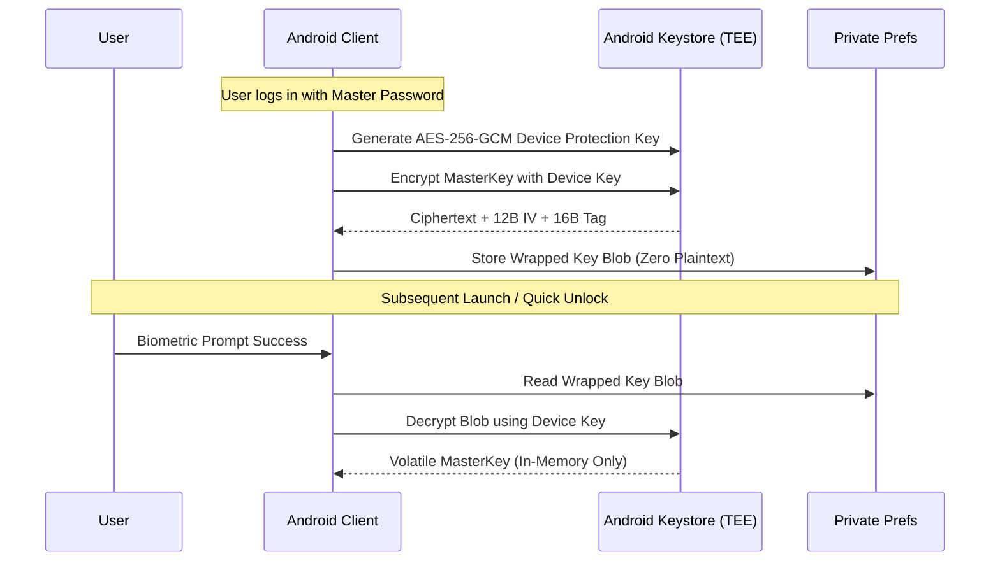

# CloudVault — Milestone M6 Android Keystore Integration
## Hardware-Backed Device Protection & Key Lifecycle Specification

**Document Version:** 1.0.0  
**Target Milestone:** M6 (Native Android Application)  
**Author:** Mobile Security Engineer & Cryptography Architect  
**Component:** `app.cloudvault.android.data.crypto.KeystoreManager`

---

## 1. Architectural Purpose & Security Boundaries

Android Keystore provides hardware-backed cryptographic key protection (via Secure Element or Trusted Execution Environment / TEE). In CloudVault, Android Keystore is utilized specifically for **Device-Bound Quick Unlock**:
- **Not a Replacement for CloudVault MasterKey:** The Keystore key does NOT replace the zero-knowledge MasterKey. It acts as an outer hardware-bound wrapping layer that encrypts the MasterKey on the local device.
- **Biometric Binding:** Allows users to unlock their vault with Fingerprint/Face biometric authentication without typing their full master password every session.
- **Automatic Invalidation:** If the user alters their device lock screen (e.g. removes PIN, enrolls a new biometric fingerprint), Android Keystore automatically invalidates the protection key, forcing full password re-entry.

---

## 2. Key Lifecycle & Generation Parameters

The device protection key is created via `KeyGenParameterSpec`:
- **Provider:** `AndroidKeyStore`
- **Key Alias:** `CloudVaultDeviceProtectionKey`
- **Algorithm:** `KeyProperties.KEY_ALGORITHM_AES`
- **Block Mode:** `KeyProperties.BLOCK_MODE_GCM`
- **Encryption Padding:** `KeyProperties.ENCRYPTION_PADDING_NONE`
- **Key Size:** 256 bits

```kotlin
val builder = KeyGenParameterSpec.Builder(
    KEY_ALIAS,
    KeyProperties.PURPOSE_ENCRYPT or KeyProperties.PURPOSE_DECRYPT
)
    .setBlockModes(KeyProperties.BLOCK_MODE_GCM)
    .setEncryptionPaddings(KeyProperties.ENCRYPTION_PADDING_NONE)
    .setKeySize(256)
    .setUserAuthenticationRequired(false) // Triggered via BiometricPrompt
```

---

## 3. Key Wrapping & Persistence Architecture

When the user logs in and enables "Biometric / Quick Unlock":
1. The 32-byte in-memory `MasterKey` is encrypted using the Keystore key with AES-256-GCM.
2. A random 12-byte IV is generated by the cipher.
3. The resulting ciphertext, IV, and 16-byte authentication tag are saved to private app storage (`cv_keystore_vault` SharedPreferences).
4. **No Plaintext Stored:** Only ciphertext is persisted to disk. The hardware-bound key inside the TEE is required to decrypt it.



---

## 4. Key Invalidation & Edge Case Handling

1. **Device Lock Screen Removal / Biometric Changes:**
   - Any attempt to decrypt with a key invalidated by enrollment changes throws `KeyPermanentlyInvalidatedException`.
   - `KeystoreManager` catches this exception, purges the stored wrapped key blob, and redirects the user to the Login screen with an explanatory message.
2. **App Reinstall & Backup Exclusion:**
   - `data_extraction_rules.xml` explicitly excludes `sharedpref`, `database`, and private files from Android Auto-Backup.
   - Keystore keys are non-exportable and cannot be restored onto a new device via cloud backup. A fresh login is strictly enforced.
3. **Logout & Zeroization:**
   - When the user taps "Log Out", `KeystoreManager.clearDeviceBoundMasterKey()` explicitly deletes the key alias from `AndroidKeyStore` and wipes preferences.
