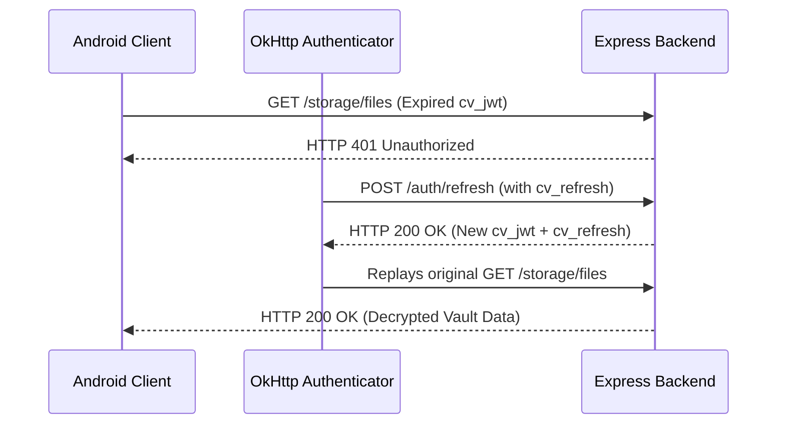

# CloudVault — Milestone M6 API Integration
## Native Android REST API Specification & Networking Guide

**Document Version:** 1.0.0  
**Target Milestone:** M6 (Native Android Application)  
**Author:** Backend Integration Lead & Mobile Network Architect  
**Client Implementation:** `app.cloudvault.android.data.api.CloudVaultApiClient`

---

## 1. Network Client Architecture

The native Android application communicates with the CloudVault backend using a high-performance OkHttp client:
- **Base URL:** `http://10.0.2.2:3000/api/v1` (Android Emulator loopback) or configurable production host.
- **CSRF Policy Enforcement:** Every outgoing HTTP request injects the mandatory custom header:
  ```http
  x-cloudvault-client: android
  ```
- **Session Cookie Preservation:** The custom `CookieJar` in `CloudVaultApiClient` transparently manages HTTP-only session cookies:
  - `cv_jwt`: Access token (15-minute expiration)
  - `cv_refresh`: Refresh token (7-day expiration, subject to family rotation)

---

## 2. API Endpoint Matrix

### A. Authentication Endpoints (Milestone M3)

| Method | Endpoint | Request Body | Response Body | Description |
| :--- | :--- | :--- | :--- | :--- |
| `POST` | `/auth/pre-login` | `{ email }` | `{ email, saltHex, kdfVersion, exists }` | Anti-enumeration salt derivation |
| `POST` | `/auth/register` | `{ email, authKeyHex, wrappedMasterKey, recoveryWrappedMasterKey, kdfSaltHex, recoveryMnemonicHash }` | `{ user, tokens }` | Zero-knowledge registration |
| `POST` | `/auth/login` | `{ email, authKeyHex, deviceName }` | `{ user, wrappedMasterKey, tokens }` | Authenticates AuthKey & returns wrapped keys |
| `POST` | `/auth/refresh` | `{ refreshToken }` or Cookie | `{ user, tokens }` | Rotates refresh token family |
| `POST` | `/auth/logout` | `{}` | `{ success: true }` | Clears server session family |
| `POST` | `/auth/verify-email` | `{ code }` | `{ success: true }` | Validates 6-digit email token |
| `POST` | `/auth/resend-verification` | `{ email }` | `{ success: true }` | Resends verification token |

### B. Storage Endpoints (Milestone M4)

| Method | Endpoint | Request Body | Response Body | Description |
| :--- | :--- | :--- | :--- | :--- |
| `POST` | `/storage/upload/init` | `{ expectedSizeBytes, totalChunks, folderId }` | `{ fileId, uploadId, chunkUrls }` | Reserves quota & issues S3 PUT URLs |
| `POST` | `/storage/upload/complete` | `{ fileId, uploadId, nameEncryptedHex, mimeTypeEncryptedHex, ivHex, wrappedFek, parts }` | `{ file }` | Commits metadata & verifies S3 upload size |
| `GET` | `/storage/files` | Query: `?folderId=` | `{ files: [ ... ], total }` | Lists encrypted file metadata records |
| `GET` | `/storage/files/:id/download` | None | `{ file, downloadUrls: [ ... ] }` | Issues presigned S3 GET URLs |
| `DELETE` | `/storage/files/:id` | None | `{ success: true }` | Moves file to trash / deletes |
| `POST` | `/storage/folders` | `{ nameEncryptedHex, ivHex, parentId }` | `{ folder }` | Creates new encrypted folder |
| `GET` | `/storage/folders` | Query: `?parentId=` | `{ folders: [ ... ] }` | Lists encrypted folders |
| `GET` | `/storage/quota` | None | `{ usedBytes, totalBytes, percentage }` | Retrieves real-time storage quota usage |

---

## 3. Silent Session Refresh Protocol


