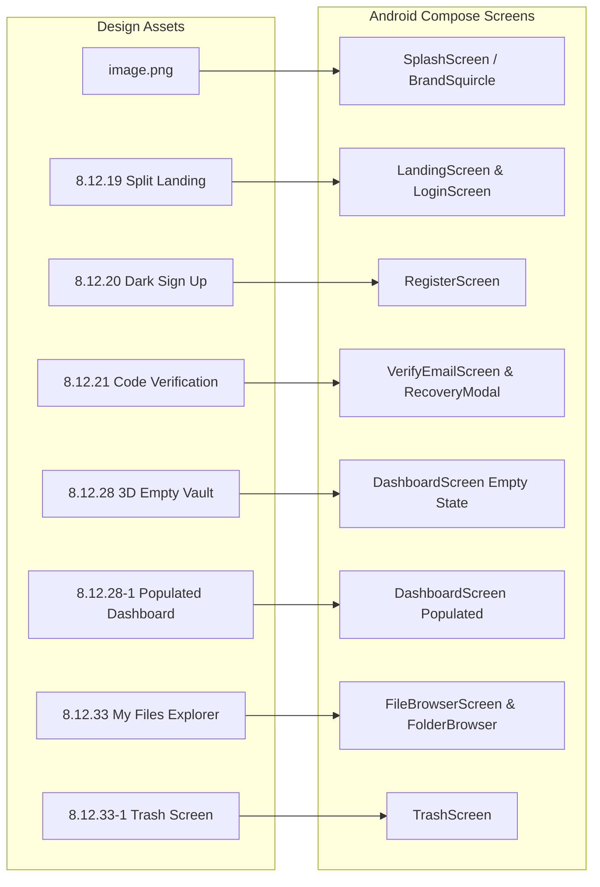

# CloudVault — Milestone M6 Design System
## Native Android Jetpack Compose UI/UX Tokenization & Reference Asset Specification

**Document Version:** 1.0.0  
**Target Milestone:** M6 (Native Android Application)  
**Author:** Principal UI/UX Architect & Mobile Design Engineer  
**Source References:** `image.png` and 32 WhatsApp Design Reference Screenshots (`WhatsApp Image 2026-11-12 at 8.12.*.jpeg`)

---

## 1. Visual Design Philosophy & Invariant Rules

CloudVault's visual identity combines high-security cryptography with an ethereal, cosmic space aesthetic:
1. **Never Generic Material 3:** While using Material 3 primitives under the hood for accessibility and touch targets, the visual presentation strictly reproduces the bespoke CloudVault cosmic aesthetic.
2. **Deep Space Void & Lavender Themes:**
   - **Dark Mode (Default):** Deep galactic void (`#0D0B18` to `#161226`) with purple nebula glows and high-contrast white/lavender typography.
   - **Light Mode:** Ethereal lavender atmospheric tone (`#F0F0F0` base, `#E0E0F0` secondary, `#F0E0F0` cards).
3. **The Brand Squircle:** The official logo (`image.png`) features a deep purple rounded squircle with a continuous white orbital ring circling a stylized cloud/vault globe.
4. **Pedestal & Glowing Accents:** Key visual anchors (empty vault folder, floating upload FAB) feature a 3D elevated pedestal with subtle neon purple diffuse drop shadows.

---

## 2. Design Token Palette (Extracted from Reference Asset Tables)

### A. Primary Background Palette (`WhatsApp Image ... 8.12.31 PM.jpeg`)

| Token Name | Hex Code | Android Compose Representation | Usage Description |
| :--- | :--- | :--- | :--- |
| `AppBackgroundLight` | `#F0F0F0` | `Color(0xFFF0F0F0)` | Soft near-white base for light theme |
| `AppBackgroundDark` | `#0D0B18` | `Color(0xFF0D0B18)` | Deep cosmic void base for dark theme |
| `SecondaryBackground` | `#E0E0F0` | `Color(0xFFE0E0F0)` | Lavender-gray atmospheric tone |
| `CardBackgroundLight` | `#F0E0F0` | `Color(0xFFF0E0F0)` | Blush white with purple warmth |
| `CardBackgroundDark` | `#161226` | `Color(0xFF161226)` | Translucent cosmic dark surface |
| `SurfaceLayer` | `#E0D0F0` | `Color(0xFFE0D0F0)` | Subtle elevated surface layer |
| `DividerBorder` | `#D0D0F0` | `Color(0xFFD0D0F0)` | Light periwinkle dividing border |
| `SoftAccentGlow` | `#C0C0F0` | `Color(0xFFC0C0F0)` | Dreamy UI background glow |

### B. Purple Brand Accent Palette (`WhatsApp Image ... 8.12.31 PM (1).jpeg`)

| Token Name | Hex Code | Android Compose Representation | Usage Description |
| :--- | :--- | :--- | :--- |
| `PrimaryPurple` | `#B090F0` | `Color(0xFFB090F0)` | Main brand lavender |
| `BrightAccentPurple` | `#A080F0` | `Color(0xFFA080F0)` | Call-to-action emphasis |
| `HoverLavender` | `#C0B0F0` | `Color(0xFFC0B0F0)` | Pressed / Hover feedback states |
| `MediumLavender` | `#B4A8E8` | `Color(0xFFB4A8E8)` | Interactive accents and chips |
| `DustyMauve` | `#C8B4D8` | `Color(0xFFC8B4D8)` | Placeholder & secondary icon tint |
| `DeepSoftPurple` | `#9070E0` | `Color(0xFF9070E0)` | Strong accent tone & badge borders |
| `LogoGlowPurple` | `#A890FF` | `Color(0xFFA890FF)` | Neon cosmic glow & logo highlights |

### C. Typography Palette (`WhatsApp Image ... 8.12.32 PM.jpeg`)

| Token Name | Hex Code | Compose Color | Usage Description |
| :--- | :--- | :--- | :--- |
| `HeadingLight` | `#2B2B3C` | `Color(0xFF2B2B3C)` | Dark charcoal-purple heading |
| `HeadingDark` | `#FFFFFF` | `Color(0xFFFFFFFF)` | Pure white contrast heading |
| `SecondaryText` | `#5E5E73` | `Color(0xFF5E5E73)` | Muted readable gray-purple text |
| `SecondaryTextDark` | `#A3A1BD` | `Color(0xFFA3A1BD)` | High-contrast secondary gray-lavender |
| `PlaceholderText` | `#8D8DA5` | `Color(0xFF8D8DA5)` | Soft inactive text & input placeholders |
| `LinkPurple` | `#8F6BFF` | `Color(0xFF8F6BFF)` | Interactive text links & text buttons |
| `DisabledText` | `#B6B6C9` | `Color(0xFFB6B6C9)` | Low-emphasis & disabled actions |

### D. Button & Interactive Gradients (`WhatsApp Image ... 8.12.32 PM (1).jpeg`)

| Component | Start Color | End Color | Description |
| :--- | :--- | :--- | :--- |
| `PrimaryButtonBrush` | `#A784FF` | `#8F6BFF` | LinearGradient horizontal CTA brush |
| `FloatingFabBrush` | `#B090F0` | `#8F6BFF` | Floating circular upload button brush |
| `CardBorderBrush` | `rgba(168,144,255,0.4)` | `rgba(255,255,255,0.05)` | Subtle translucent cosmic card border |
| `InputOutline` | `#D9D3F5` (Light) | `#352C55` (Dark) | Elegant rounded input outline |
| `FocusRing` | `#B9A7FF` | `#B9A7FF` | Active input focus indicator |

---

## 3. Screen-to-Reference Asset Mapping

Every screen implemented in `apps/android` maps directly to one or more primary visual assets:

| Android Compose Screen | Primary Reference Asset | Layout Strategy on Mobile Phone |
| :--- | :--- | :--- |
| **SplashScreen** | `image.png` | Centered 120dp BrandSquircle with pulsing glow and animated version tag. |
| **LandingScreen** | `8.12.19 PM.jpeg` | Vertical stack: Logo, headline "Your files, always safe and accessible.", 3 feature badges, and Auth action buttons. |
| **LoginScreen** | `8.12.19 PM.jpeg` (Right Pane) | Cosmic card with email, password with eye toggle, forgot password link, and gradient CTA button. |
| **RegisterScreen** | `8.12.20 PM.jpeg` | Full name, email, password, confirm password, 3 criteria checkboxes (8 chars, 1 uppercase, 1 number), Terms checkbox, gradient "Sign Up" button. |
| **VerifyEmailScreen** | `8.12.21 PM.jpeg` | Center envelope icon with glowing shield, 6 individual digit input boxes, expiry countdown timer, and "Resend Code" link. |
| **RecoveryKitSetupScreen** | ADR-007 / M1 Spec | 24-word grid in 2 columns with numbered word pills, copy to clipboard, and confirmation warning banner. |
| **RecoveryKitVerifyScreen** | ADR-007 | 3 random word challenges (e.g. Word #4, #12, #19) with interactive word chips. |
| **DashboardScreen** | `8.12.28 PM.jpeg` & `8.12.28 PM (1).jpeg` | Sticky top greeting ("Welcome back! 👋"), Storage usage ring card, quick statistics row, recent files list, and floating circular upload FAB. |
| **FileBrowserScreen** | `8.12.33 PM.jpeg` | Breadcrumb trail, Search bar, New Folder button, List/Grid toggle, and file items with filetype badges and 3-dot context menu. |
| **FolderBrowserScreen** | `8.12.33 PM.jpeg` | Dedicated hierarchy navigation with folder creation and batch file selection. |
| **FileDetailsScreen** | W4 Spec | Encrypted file metadata, size, upload date, FEK status badge, and Download / Delete buttons. |
| **UploadManagerScreen** | W2 / M4 Spec | Active background upload queue, chunk progress bars, transfer speeds, and pause/retry controls. |
| **DownloadManagerScreen**| W2 / M4 Spec | Active background download queue, decryption status, and SAF destination selector. |
| **TrashScreen** | `8.12.33 PM (1).jpeg` | 30-day retention warning banner, empty trash button, and file items with "X days left" countdown. |
| **AccountSettingsScreen**| W11 Spec | User profile, email verification status, change password (with zero re-encryption), and logout. |
| **SecuritySettingsScreen**| W11 Spec | Device Keystore quick unlock toggle, biometric prompt enrollment, and recovery phrase export. |
| **SessionManagementScreen**| M3 Spec | Active session list, device type, IP address, last active timestamp, and "Revoke All Other Sessions" button. |
| **StorageUsageScreen** | `8.12.29 PM.jpeg` | Full circular donut breakdown (Documents, Images, Videos, Others) with tier quota meter. |
| **KnownLimitationsScreen**| `docs/KNOWN_LIMITATIONS.md`| Explicit disclosures: 30-day orphan grace period notice (`RESTORATION NOT YET AVAILABLE`), physical device benchmark status, and web trust notes. |

---

## 4. Canonical Compose Component Specifications

### 1. `BrandSquircle`
- Custom Compose Canvas drawing a rounded rect with $R=28\text{dp}$.
- Background: Radial gradient from `#7C3AED` to `#4C1D95`.
- Foreground: White vector path representing the planet globe and 45-degree tilted orbital ring with drop shadow.

### 2. `StorageDonutRing`
- Canvas arc with stroke width $14\text{dp}$.
- Track: Subtle background ring (`#2D234D`).
- Indicator: Gradient arc (`#A784FF` → `#8F6BFF`) displaying percentage consumed.
- Center Content: Bold current storage value ("128 GB") with secondary limit ("of 500 GB").

### 3. `EmptyVaultPedestal`
- Custom illustration matching `8.12.28 PM.jpeg`.
- 3D elliptical pedestal in soft glowing purple with diffuse drop shadow.
- Center 3D purple folder icon with cloud emblem.
- Subtitle: "No files uploaded yet. Your secure cloud space is ready."

### 4. `FloatingUploadFab`
- 64dp circular floating action button with linear gradient brush (`#B090F0` → `#8F6BFF`).
- Centered white upload cloud arrow icon.
- Shadow elevation: 8dp with soft purple diffuse glow (`rgba(168, 144, 255, 0.4)`).

