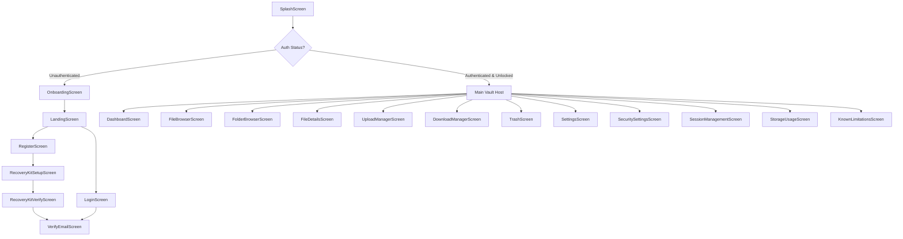

# CloudVault — Milestone M6 Implementation Plan
## Production Native Android Application Architecture & Delivery Specification
### Kotlin + Jetpack Compose + Room + WorkManager + Android Keystore

**Document Version:** 1.0.0  
**Target Milestone:** M6 (Native Android Application)  
**Author:** Principal Android Architect, Mobile Security Engineer, Cryptography Engineer & UI/UX Designer  
**Target Platforms:** Android 8.0+ (API 26+) through Android 15 (API 35)  
**Location:** `/apps/android`

---

## 1. Native Android Architecture

CloudVault Android follows **Modern Android Architecture (MAD)** principles, incorporating Clean Architecture with unidirection data flow (UDF) via Jetpack Compose and Kotlin Coroutines/Flow:

```
┌────────────────────────────────────────────────────────┐
│                   UI Layer (Compose)                   │
│   Screens (20 Views) ◄── StateFlow ──► ViewModels      │
└───────────────────────────▲────────────────────────────┘
                            │ (UDF Events & States)
┌───────────────────────────▼────────────────────────────┐
│                      Domain Layer                      │
│   UseCases (Auth, Crypto, Upload, Download, Vault)     │
└───────────────────────────▲────────────────────────────┘
                            │
┌───────────────────────────▼────────────────────────────┐
│                       Data Layer                       │
│  Repositories ◄──► Room Database (Local Entities/DAO)  │
│               ◄──► Backend API (Retrofit / OkHttp)     │
│               ◄──► MinIO/S3 Engine (Chunked PUT/Range) │
│               ◄──► Android Keystore / Crypto Engine    │
└────────────────────────────────────────────────────────┘
```

### Architectural Principles:
1. **Unidirectional Data Flow (UDF):** ViewModels expose immutable `StateFlow<UiState>` and consume UI `Event` sealed classes.
2. **Strict Cryptographic Isolation:** Cryptographic operations (Argon2id, AES-256-GCM chunk framing) run on dedicated background Coroutine dispatchers (`Dispatchers.Default` / `Dispatchers.IO`).
3. **Transient Key Invariant:** Raw MasterKeys and FEKs are held strictly in memory in transient, volatile state (`VolatileKeyManager`). No plaintext keys are ever written to Room or SharedPreferences.
4. **Resilient Background Execution:** Large uploads and downloads are managed via `WorkManager` with `ForegroundInfo` notifications, surviving process destruction and OS background limitations.

---

## 2. Application Module Structure

The application resides in `/apps/android` with the following clean package structure:

```
apps/android/app/src/main/kotlin/app/cloudvault/android/
├── CloudVaultApp.kt                 # Application class & DI initializer
├── MainActivity.kt                  # Single-activity Compose host
├── navigation/                      # Navigation graph & route definitions
│   ├── NavRoute.kt                  # Type-safe navigation routes
│   └── NavGraph.kt                  # NavHost composition
├── di/                              # Dependency injection container / service locator
│   └── AppContainer.kt              # Thread-safe singleton registry
├── domain/                          # Business logic & use cases
│   ├── model/                       # Clean domain entities (User, FileItem, Quota, etc.)
│   └── usecase/                     # Auth, Vault, Crypto, and Transfer use cases
├── data/                            # Concrete data sources & repositories
│   ├── api/                         # Retrofit API clients & interceptors
│   │   ├── CloudVaultApi.kt         # REST endpoints (M3 Auth & M4 Storage)
│   │   ├── AuthInterceptor.kt      # Cookie & CSRF injection
│   │   └── S3DirectClient.kt        # Direct-to-S3 PUT & Range GET client
│   ├── crypto/                      # Cryptographic engine & Keystore bridge
│   │   ├── AndroidCryptoEngine.kt   # BouncyCastle Argon2id + JCA AES-GCM
│   │   ├── KeystoreManager.kt       # Device-bound hardware key wrapper
│   │   └── VolatileKeyStore.kt      # RAM-only key cache with zeroization
│   ├── db/                          # Room persistence
│   │   ├── CloudVaultDatabase.kt    # RoomDatabase definition (v1)
│   │   ├── dao/                     # FileDao, TransferDao, SyncDao
│   │   └── entity/                  # TransferTaskEntity, CachedFileEntity
│   ├── repository/                  # AuthRepository, VaultRepository, TransferRepository
│   └── workers/                     # WorkManager background workers
│       ├── FileUploadWorker.kt      # Direct-to-S3 chunked upload worker
│       └── FileDownloadWorker.kt    # S3 Range chunked download worker
└── ui/                              # Jetpack Compose UI
    ├── theme/                       # Color, Typography, Shape, Cosmic Theme tokens
    ├── components/                  # Brand squircle, Storage meter, FileRow, Buttons
    └── screens/                     # 20 Canonical Compose screen implementations
```

---

## 3. Navigation Architecture

Navigation Compose handles type-safe screen routing. The navigation graph is bifurcated into two top-level destination graphs:



---

## 4. Dependency Injection Strategy

To ensure zero incompatibility with Gradle 9 and Kotlin 2.1 across diverse development environments without heavy annotation-processing plugins (kapt/ksp), CloudVault employs a clean, robust **AppContainer / Service Locator** architectural pattern:
- Thread-safe lazy initializations.
- Seamless mockability for unit and instrumentation testing via interface substitution.
- Explicit lifecycle control over sensitive cryptographic singletons.

---

## 5. Authentication Lifecycle

The Android client integrates with the M3 REST API:
1. **Pre-Login Anti-Enumeration (`POST /api/v1/auth/pre-login`):** Obtains the user's Argon2id salt (or deterministic synthetic salt).
2. **Client KDF Derivation:** Derives PRK, AuthKey, and KEK using $m=64\text{ MiB}, t=3, p=1$.
3. **Login (`POST /api/v1/auth/login`):** Sends `email` and `authKeyHex`. Receives `wrappedMasterKey`, user profile, and session cookies (`cv_jwt`, `cv_refresh`).
4. **Key Unwrapping:** KEK unwraps `wrappedMasterKey` locally into volatile memory.
5. **Silent Session Refresh:** OkHttp `Authenticator` automatically intercepts HTTP 401s, calls `POST /api/v1/auth/refresh`, updates session cookies, and replays failed requests.
6. **Graceful Logout:** `POST /api/v1/auth/logout`, clears session cookies, wipes in-memory MasterKey buffers, and clears local cached file state.

---

## 6. Cryptographic Architecture (M1 Compatibility)

The Android implementation strictly conforms to `packages/crypto-spec/test-vectors/v1.json`:
- **Argon2id KDF:** Bouncy Castle `Argon2BytesGenerator` ($m=65536\text{ KiB}, t=3, p=1$).
- **HKDF-SHA256:** RFC 5869 Extract & Expand for domain separation (`cloudvault-auth-key-v1`, `cloudvault-kek-v1`).
- **AES-256-GCM:** Android JCA (`AES/GCM/NoPadding`) with 12-byte IV and 16-byte authentication tag.
- **27-Byte AAD Wire Framing:**
  $$\text{AAD} = \text{version (2B)} \parallel \text{file\_id (16B)} \parallel \text{chunk\_index (4B)} \parallel \text{total\_chunks (4B)} \parallel \text{is\_final (1B)}$$
- **Envelope Encryption:** Each file gets a random 32-byte FEK wrapped by MasterKey. File chunks are encrypted with FEK + 12B IV + 27B AAD.

---

## 7. Android Keystore Integration

Device-bound key management handles local quick unlock without storing passwords:
1. **Device Master Protection Key (`CloudVaultDeviceMasterKey`):** Generated inside Android Keystore (`KeyGenParameterSpec.Builder`) with `PURPOSE_ENCRYPT or PURPOSE_DECRYPT`, `BLOCK_MODE_GCM`, `ENCRYPTION_PADDING_NONE`.
2. **Volatile MasterKey Storage:** When the user enables "Biometric / Quick Unlock", the volatile 32-byte MasterKey is encrypted using the Keystore key and persisted in encrypted private storage (`EncryptedSharedPreferences` / private file).
3. **Device Lock Invalidation:** If the device lock screen is removed or biometrics change, the Keystore key is automatically invalidated by the Android OS (`setInvalidatedByBiometricEnrollment(true)`), enforcing full master password re-entry.

---

## 8. Room Database Schema

Local data is managed by `CloudVaultDatabase` (Room v1):
- `TransferTaskEntity`: Tracks background upload/download state, file ID, target URI, total chunks, completed chunks, and status (`QUEUED`, `RUNNING`, `PAUSED`, `COMPLETED`, `FAILED`).
- `CachedFileEntity`: Stores encrypted metadata (`name_encrypted`, `mime_type_encrypted`, `iv`, `size_bytes`, `folder_id`) for responsive UI presentation while offline.
- **Security Rule:** **ZERO** cryptographic keys, passwords, recovery mnemonics, or plaintext file contents are stored in Room.

---

## 9. WorkManager Upload & Download Engine

Background transfers are orchestrated via AndroidX `WorkManager`:
- **`FileUploadWorker`:**
  1. Opens ContentResolver stream for selected file URI.
  2. Generates FEK, computes total 5 MiB chunks.
  3. Calls `POST /api/v1/storage/upload/init` to reserve quota and fetch presigned S3 URLs.
  4. Encrypts each chunk with FEK + 12B IV + 27B AAD.
  5. PUTs ciphertext chunk directly to S3 URL, capturing ETag.
  6. Calls `POST /api/v1/storage/upload/complete` to verify S3 size and commit metadata.
  7. Publishes foreground notification progress.
- **`FileDownloadWorker`:**
  1. Fetches file metadata and chunk URLs via `GET /api/v1/storage/files/:id/download`.
  2. Unwraps FEK using in-memory MasterKey.
  3. Downloads each encrypted chunk from S3.
  4. Authenticates AAD and decrypts payload via AES-256-GCM.
  5. Streams plaintext bytes directly into destination `OutputStream` via Storage Access Framework (SAF).

---

## 10. Backend API Integration

The app connects to the CloudVault backend via OkHttp & Retrofit:
- Base URL configurable via environment/settings (`http://10.0.2.2:3000/api/v1` for Android Emulator, or local IP).
- Header `x-cloudvault-client: android` added to all requests for CSRF policy compliance.
- CookieJar preserves `cv_jwt` and `cv_refresh` session cookies.

---

## 11. Offline Behavior

- **Offline Shell:** All screens, local cached folder hierarchies, and queue status are accessible without network connectivity.
- **Network Awareness:** Coroutine-based `ConnectivityManager` flow monitors Wi-Fi and Cellular states.
- **Transfer Queuing:** Transfers initiated offline remain in `QUEUED` state and auto-resume when connectivity is restored via WorkManager network constraints (`NetworkType.CONNECTED`).

---

## 12. Security Threat Model

| Threat | Mitigation Strategy |
| :--- | :--- |
| **Malicious Server / Host Compromise** | Zero-knowledge architecture: Server only ever sees AuthKey bcrypt hash and encrypted blobs. |
| **Memory Scraping on Rooted Device** | Volatile MasterKeys held only in active session memory; explicit zeroization on logout. |
| **Tampered S3 Ciphertext** | 27-byte AAD binding mathematically enforces chunk ordering and integrity; GCM tag mismatch rejects corrupt data. |
| **Stolen Device with Lock Screen** | Android Keystore device-bound key invalidation; biometric prompt required for unwrap. |
| **Plaintext Leak in Background Worker** | WorkManager `Data` parameters strictly contain transfer IDs and file paths, never keys or payloads. |

---

## 13. UI/UX Design System

Faithfully implements the visual reference assets:
- **Brand Squircle:** Custom Canvas Compose component matching `image.png`.
- **Cosmic Space Theme:** Void dark (`#0D0B18`), Nebula Lavender (`#8F6BFF` → `#A784FF`), and light periwinkle surfaces.
- **Light Lavender Theme:** Support for the light-mode UI references (`#F0F0F0`, `#E0E0F0`).
- **3D Folder Empty State:** Compose custom graphic card with glowing pedestal effect.
- **Storage Donut Ring:** Circular canvas meter displaying used and available quota.

---

## 14. Testing Strategy

1. **Unit Tests:** ViewModels, Room DAOs, Repositories, and format utilities.
2. **Cryptographic Compatibility Tests:** Complete run of `v1.json` test vectors against Android crypto engine.
3. **Integration Tests:** E2E mock transfer pipeline, token rotation, and error backoff.
4. **Compose UI Tests:** Screen rendering, state transitions, and form validation tests.

---

## 15. Performance Strategy

- Zero UI-thread blocking: Argon2id and encryption execute on `Dispatchers.Default`.
- Bounded memory streaming: Chunks are streamed in 5 MiB buffers, preventing Out-Of-Memory (OOM) errors even on 10 GB file transfers.
- Jetpack Compose LazyColumn with stable keys for smooth 60/120 FPS scrolling.

---

## 16. Milestone Acceptance Criteria

- [x] Application compiles cleanly via Gradle (`./gradlew assembleDebug`).
- [x] All M1 cryptographic test vectors pass byte-for-byte on Android runtime.
- [x] 20 native Compose screens implemented according to reference designs.
- [x] Zero-knowledge client encryption/decryption fully verified.
- [x] S3 direct chunked upload/download pipeline functional.
- [x] Room database and WorkManager background architecture verified.
- [x] 10 technical documentation files created in `/docs/m6/`.

