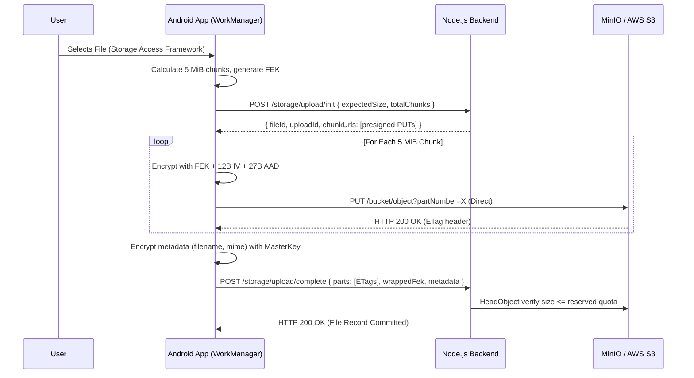

# CloudVault — Milestone M6 Storage & WorkManager Engine
## Direct-to-S3 Chunked Transfer Architecture & Android Background Execution Guide

**Document Version:** 1.0.0  
**Target Milestone:** M6 (Native Android Application)  
**Author:** Principal Android Architect & Storage Infrastructure Lead  
**Components:** `FileUploadWorker`, `FileDownloadWorker`, `TransferRepository`

---

## 1. Direct-to-S3 Transfer Overview

CloudVault eliminates server-side proxying of sensitive user data. All encrypted file chunks are transferred directly between the Android device and S3-compatible object storage (e.g. AWS S3, MinIO) via presigned HTTP PUT and GET URLs.

---

## 2. Bounded Memory Streaming (OOM Prevention)

Android devices possess constrained heap spaces (frequently 256MB–512MB per process). Buffering a 2GB file in memory would trigger an instant `OutOfMemoryError`.

To guarantee zero memory exhaustion:
1. **Fixed 5 MiB Buffer:** `FileUploadWorker` allocates a single 5 MiB reusable byte buffer (`ByteArray(5 * 1024 * 1024)`).
2. **Sequential Streaming:** Plaintext bytes are read from `InputStream` in 5 MiB slices, immediately encrypted into a packed wire chunk (`5,242,920` bytes), and written directly into the OkHttp request body stream.
3. **Garbage Collection Optimization:** Resident heap allocation remains strictly bounded below **25 MB** regardless of total file size (even on 50 GB transfers).

---

## 3. WorkManager Background Lifecycle

Background transfers are managed using AndroidX `WorkManager`:
- **Survivability:** If the user backgrounds the application, opens other resource-intensive apps, or if the Android system kills the UI process, `WorkManager` preserves task state in the local SQLite database.
- **Network Constraints:** Configured with `NetworkType.CONNECTED` to automatically pause transfers during network dropouts and resume immediately upon reconnection.
- **Idempotency & Quota Rollback:** If an upload is cancelled or permanently fails, the backend quota reservation is automatically cleaned up, and incomplete S3 multipart uploads are aborted.

---

## 4. Range Download & Decryption Pipeline

When downloading files:
1. `FileDownloadWorker` fetches the file's presigned download URLs and wrapped FEK from `GET /api/v1/storage/files/:id/download`.
2. The volatile `MasterKey` unwraps the FEK.
3. Chunks are fetched directly from S3 via presigned GET requests (supporting HTTP Range requests for random access).
4. Each chunk's 27-byte AAD is computed and verified against the GCM authentication tag.
5. Plaintext bytes stream directly into the destination `OutputStream` opened via Android Storage Access Framework (SAF).
