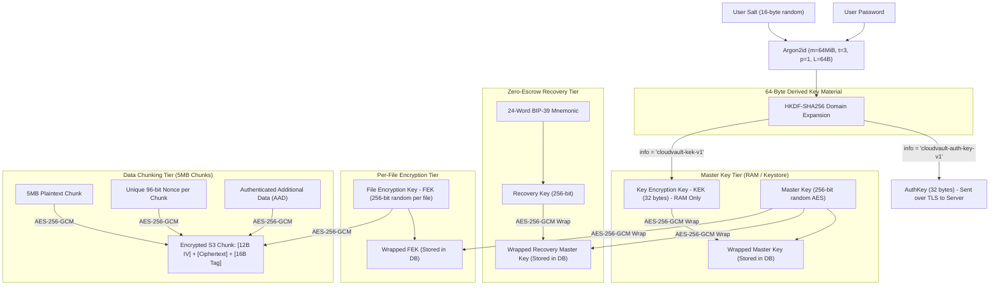

# CloudVault — Cryptographic Specification Standard (v1.0)

> **Specification Version:** 1.0.0  
> **Classification:** Open Standard / Security Architecture Single Source of Truth  
> **Status:** FROZEN  
> **Target Environments:** Web PWA (TypeScript / WebCrypto / libsodium), Android Native (Kotlin / libsodium-jni / JCA)  
> **Authors:** Akshat Vats (CV-01), Akshat Singh (CV-07)  

---

## 1. Overview & Core Security Principles

CloudVault implements a **Zero-Knowledge, End-to-End Encrypted (E2EE) envelope encryption architecture**.
1. **Zero-Knowledge Invariant:** The backend API, database, and cloud object store (AWS S3) never possess, receive, or log plaintext files, sensitive metadata (filenames, MIME types), user passwords, Key Encryption Keys (KEK), or Master Keys.
2. **Cryptographic Standards:** All symmetric primitives adhere to **NIST SP 800-38D (AES-256-GCM)**. Key derivation adheres to **RFC 9106 (Argon2id)**. Key derivation expansion adheres to **RFC 5869 (HKDF-SHA256)**. Recovery phrases adhere to **BIP-39**.
3. **No Custom Cryptography:** Implementations must use standard, audited libraries only: `libsodium` / `libsodium-wrappers-sumo` for WebAssembly, standard W3C `SubtleCrypto` for browser operations, and `libsodium-jni` / Google Tink / standard Android JCA for Kotlin.

---

## 2. Key Hierarchy Architecture



---

## 3. Key Derivation & Domain Separation (Argon2id + HKDF)

### 3.1 Argon2id Parameters
Key derivation from the user's master password uses Argon2id per **ADR-002**:
- **Algorithm:** Argon2id (RFC 9106)
- **Memory Cost ($m$):** $64\text{ MiB} = 65,536\text{ KiB}$
- **Time Cost ($t$):** $3\text{ iterations}$
- **Parallelism ($p$):** $1\text{ thread}$
- **Salt Length:** $16\text{ bytes}$ (generated via secure CSPRNG: `crypto.getRandomValues()` / `SecureRandom`)
- **Raw Output Length ($L$):** $64\text{ bytes}$

### 3.2 Domain-Separated Subkey Derivation (HKDF-SHA256)
To ensure complete cryptographic isolation between authentication and storage encryption, the 64-byte Argon2id output ($\text{PRK}$) is expanded into two distinct 256-bit keys using HKDF-Expand (RFC 5869) with distinct domain separation strings:

$$\text{AuthKey} = \text{HKDF-Expand}(\text{PRK}, \text{info} = \text{"cloudvault-auth-key-v1"}, \text{length} = 32)$$
$$\text{KEK} = \text{HKDF-Expand}(\text{PRK}, \text{info} = \text{"cloudvault-kek-v1"}, \text{length} = 32)$$

- **`AuthKey` (32 bytes):** Sent over TLS 1.3 to the backend API during login/signup. The backend **never** stores `AuthKey` directly; it applies a second slow hash (**bcrypt cost factor 12**) prior to database persistence (**ADR-012**).
- **`KEK` (32 bytes):** Retained strictly in client volatile memory. **Never transmitted to the server**. Used solely to wrap and unwrap the `MasterKey`.

---

## 4. Master Key & Envelope Key Wrapping

### 4.1 Master Key Generation
At account creation, the client generates a cryptographically random 256-bit key:
$$\text{MasterKey} \xleftarrow{\$} \{0, 1\}^{256}$$

### 4.2 Key Wrap Format (AES-256-GCM)
Keys are wrapped using AES-256-GCM with a fresh 96-bit random IV and an explicit AAD context string.
- **Master Key Wrap:**
  - Key: `KEK` (32 bytes)
  - Plaintext: `MasterKey` (32 bytes)
  - Nonce ($\text{IV}$): 12 bytes CSPRNG
  - AAD: `"cloudvault-master-key-wrap-v1"` (ASCII bytes)
  - Tag: 16 bytes GCM authentication tag
- **Wire Representation (JSON):**
  ```json
  {
    "v": 1,
    "iv": "<Base64 12 bytes>",
    "tag": "<Base64 16 bytes>",
    "ct": "<Base64 32 bytes ciphertext>"
  }
  ```

### 4.3 Password Change Workflow (Zero Re-Encryption of Files)
When a user updates their password:
1. Client derives `Old_KEK` from old password + salt.
2. Client decrypts `MasterKey` in memory using `Old_KEK`.
3. Client generates a fresh 16-byte user salt.
4. Client derives `New_KEK` and `New_AuthKey` from new password + new salt.
5. Client re-wraps `MasterKey` with `New_KEK`.
6. Client transmits `New_AuthKey` and `New_WrappedMasterKey` to server.
7. **Result:** All files remain encrypted with their existing FEKs, which remain wrapped with `MasterKey`. Zero file re-encryption is required.

---

## 5. File Encryption & Chunk Framing

### 5.1 Per-File Encryption Key (FEK)
Every file has a cryptographically unique 256-bit symmetric key:
$$\text{FEK} \xleftarrow{\$} \{0, 1\}^{256}$$
The `FEK` is wrapped with `MasterKey` using AES-256-GCM:
- Nonce ($\text{IV}$): 12 bytes CSPRNG
- AAD: `file_id` (16-byte raw UUID bytes)
- Stored in PostgreSQL `encryption_keys.wrapped_key`.

### 5.2 Chunk Sizing & S3 Multipart Constraints
AWS S3 requires all non-final parts of a multipart upload to be **at least 5 MiB (5,242,880 bytes)**:
- **Plaintext Chunk Size ($S_{\text{plain}}$):** Exactly $5,242,880\text{ bytes}$ ($5\text{ MiB}$) for chunks $0$ to $N-2$.
- **Chunk Overhead:** $12\text{ bytes (IV)} + 16\text{ bytes (Tag)} = 28\text{ bytes}$.
- **Ciphertext Chunk Size ($S_{\text{cipher}}$):** Exactly $5,242,908\text{ bytes}$ ($> 5\text{ MiB}$, perfectly compliant with AWS S3).
- **Final Chunk ($N-1$):** Size between $29\text{ bytes}$ (1 byte plaintext + 28 bytes overhead) and $5,242,908\text{ bytes}$.

### 5.3 Chunk Wire Layout
Every S3 part is stored with its IV prepended and GCM tag appended:
```text
+-----------------------+----------------------------------+-----------------------+
|  12-byte IV / Nonce   |     AES-256-GCM Ciphertext       |   16-byte Auth Tag    |
|       (Bytes 0..11)   |       (Bytes 12 .. L-17)         |   (Bytes L-16 .. L-1) |
+-----------------------+----------------------------------+-----------------------+
```

### 5.4 Authenticated Additional Data (AAD) Definition
Every chunk binds a 27-byte structured AAD buffer to guarantee authenticated cryptographic integrity:

```text
Byte Offset | Length | Field Name        | Type / Encoding
------------|--------|-------------------|--------------------------------------------------
0 .. 1      | 2      | format_version    | uint16 (Big-Endian) = 0x0001
2 .. 17     | 16     | file_id           | UUID raw 16 bytes (RFC 4122 binary)
18 .. 21    | 4      | chunk_index       | uint32 (Big-Endian) (0-indexed: 0, 1, 2...)
22 .. 25    | 4      | total_chunks      | uint32 (Big-Endian) (e.g. 10)
26          | 1      | is_final          | uint8 (0x01 if chunk_index == total_chunks - 1, else 0x00)
```

**Security Guarantees Provided by AAD:**
- **Anti-Chunk-Swapping:** An attacker cannot replace chunk 2 of file A with chunk 2 of file B (fails `file_id` check).
- **Anti-Reordering:** An attacker cannot swap chunk 1 and chunk 2 (fails `chunk_index` check).
- **Anti-Truncation:** An attacker cannot drop the last chunk (fails `total_chunks` and `is_final` check).

### 5.5 Nonce / IV Strategy
- **Generation:** Fresh 96-bit random IV generated via secure CSPRNG for every chunk.
- **Safety Proof:** Because every file is encrypted with a cryptographically unique 256-bit FEK, the probability of an IV collision across $K$ chunks for a single key is given by $P \approx \frac{K^2}{2 \cdot 2^{96}}$. For a 1 TB file ($K \approx 200,000$ chunks), $P \approx \frac{4 \times 10^{10}}{2^{97}} \approx 2^{-66}$, which is negligibly small and well within NIST SP 800-38D bounds ($< 2^{-32}$).

### 5.6 Streaming & Unknown-Length Handling
For standard file uploads (99.9% of user workloads: Web file picker, drag-and-drop, Android MediaStore/document selector), file length is known in advance via `File.size` or `Content-Length`. Thus, `total_chunks = ceil(file_size / 5242880)` is calculated before the first chunk is encrypted, satisfying the frozen v1 AAD contract.

For **unknown-length streaming sources** (e.g., live microphone audio, live camera recording, pipes):
1. **Client Spooling / Buffer Strategy:** The client spools the streaming data to a local temporary buffer/file (Android cache directory or browser OPFS / Origin Private File System). Once the stream ends or reaches a predefined segment size, the file length is finalized (`stat`), `total_chunks` is determined, and chunked encryption proceeds.
2. **Trade-offs Evaluated:**
   - *Option A (Client Spooling / Buffer):* Preserves the frozen v1 27-byte AAD binding with zero spec alterations and strict anti-truncation security. Requires temporary local storage.
   - *Option B (Manifest / Two-Pass):* Stream parts encrypted with `is_final` flag only, with a final signed manifest chunk. Increases protocol complexity and requires format_version bump.
   - *Option C (Omit `total_chunks` from AAD):* Weakens truncation protection since an attacker could truncate chunks before `is_final` without tag invalidation unless a chain hash is used.
3. **Specification Standard:** Option A is standard for CloudVault v1.0. Streaming inputs MUST be spooled to local temporary storage before upload session initialization. The 27-byte AAD layout remains immutable and frozen.

---

## 6. Metadata Encryption Specification

### 6.1 Encrypted File & Folder Attributes
Filenames, folder names, MIME types, and file attributes are encrypted client-side per **ADR-004**:
- **Key:** File `FEK` (for files) or Directory Key (for folders).
- **Cipher:** AES-256-GCM.
- **Nonce:** 12-byte CSPRNG random IV.
- **AAD:** `format_version (2B) || file_id (16B UUID) || "cloudvault-metadata-v1"`.
- **Plaintext Payload (JSON):**
  ```json
  {
    "name": "Q4_Financial_Report.pdf",
    "mime": "application/pdf",
    "size": 15420390,
    "last_modified": 1731448800000
  }
  ```
- **Database Storage:** PostgreSQL `files.encrypted_name` stores the Base64 ciphertext, and `files.name_nonce` stores the 12-byte Base64 IV.

---

## 7. Emergency Recovery Kit Specification (Zero-Escrow)

### 7.1 BIP-39 24-Word Mnemonic Derivation
1. Client generates 256 bits of cryptographically secure entropy.
2. Derives 24 words using standard BIP-39 English wordlist.
3. Derives 64-byte seed via BIP-39 PBKDF2:
   $$\text{Seed} = \text{PBKDF2-HMAC-SHA512}(\text{mnemonic}, \text{salt} = \text{"mnemonic"}, 2048\text{ iterations})$$
4. `RecoveryKey` (32 bytes) = $\text{Seed}[0..31]$.
5. `MasterKey` is wrapped with `RecoveryKey` using AES-256-GCM:
   - Nonce: 12 bytes CSPRNG
   - AAD: `"cloudvault-recovery-wrap-v1"`
   - Stored in PostgreSQL `users.encrypted_recovery_kek`.
6. **Challenge-Response Signup Gate:** During onboarding, client prompts the user to re-enter 3 to 4 randomly chosen words (e.g., words #4, #12, #21) before account creation succeeds.

---

## 8. Zero-Knowledge Public Link Sharing

### 8.1 URL Fragment Passing (`#key=...`)
Per RFC 3986, HTTP clients do not transmit URI fragments to web servers.
- **Share Link Format:**
  `https://cloudvault.app/share/:token#key=<base64_encoded_fek>`
- **Workflow:**
  1. Owner creates share record in DB (token, expiry, max downloads).
  2. Owner appends `#key=<base64_fek>` to generated link.
  3. Recipient opens link; browser receives HTML/JS and queries `GET /api/v1/shares/:token` for ciphertext S3 URL.
  4. Recipient extracts `window.location.hash`, parses `FEK`, streams ciphertext, and decrypts locally.
- **Password Protection (Optional Extra Wrap):**
  If enabled, the `FEK` in the fragment is wrapped with an Argon2id key derived from the share password:
  $$\text{ShareKEK} = \text{Argon2id}(\text{share\_password}, \text{share\_salt}, t=3, m=65536, p=1)$$
  $$\text{ProtectedFEK} = \text{AES-256-GCM-Wrap}(\text{ShareKEK}, \text{FEK})$$

---

## 9. Versioning & Future Migration Rules

- Every encrypted structure contains `v: 1` (`format_version = 0x0001`).
- User records store KDF algorithm and parameters (`kdf_version = "1.0"`).
- Upgrades to KDF (e.g. higher memory cost) occur opportunistically at successful user login without requiring data re-encryption.

---

## 10. Operational Limits, Constraints & Constants

| Constant / Limit | Value | Architectural Justification |
| :--- | :--- | :--- |
| `DEFAULT_CHUNK_SIZE` | `5,242,880 bytes` (5 MiB) | Exact minimum part size permitted by AWS S3 Multipart API. |
| `CHUNK_FRAMING_OVERHEAD` | `28 bytes` | 12 bytes IV + 16 bytes GCM authentication tag. |
| `MAX_CIPHERTEXT_CHUNK_SIZE` | `5,242,908 bytes` | Plaintext chunk size (5 MiB) + framing overhead (28 bytes). |
| `S3_MAX_MULTIPART_PARTS` | `10,000 parts` | Hard limit enforced by AWS S3 / MinIO multipart upload API. |
| `MAX_FILE_SIZE_V1` | `52,428,800,000 bytes` (~48.83 GiB) | Calculated as $10,000 \text{ parts} \times 5\text{ MiB}$. Sufficient for 99.99% CloudVault user files. Files exceeding 48.83 GiB in future tiers will increase chunk size to 16 MiB or 64 MiB. |
| `MAX_FILE_NAME_LENGTH` | `255 characters` (UTF-8) | Standard filesystem limitation (Linux, Android, Windows, macOS). Encrypted name fits easily in 1024-byte column. |
| `MAX_AAD_LENGTH` | `27 bytes` | Fixed-size binary struct preventing ambiguity or parsing overhead. |
| `MIN_PASSWORD_LENGTH` | `12 characters` | Enforced at registration alongside entropy check before Argon2id KDF. |


